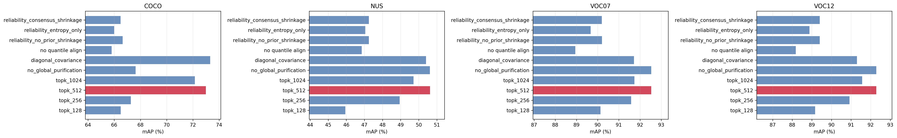
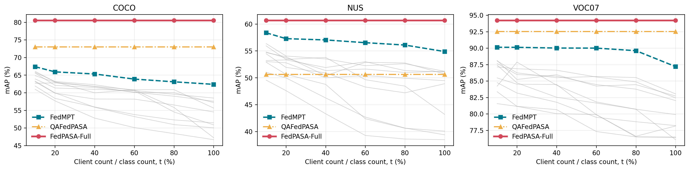
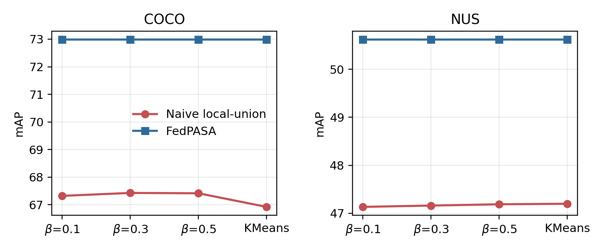
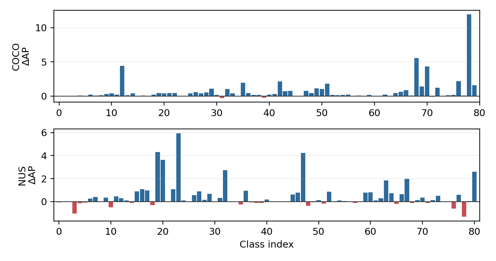
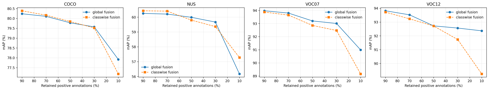
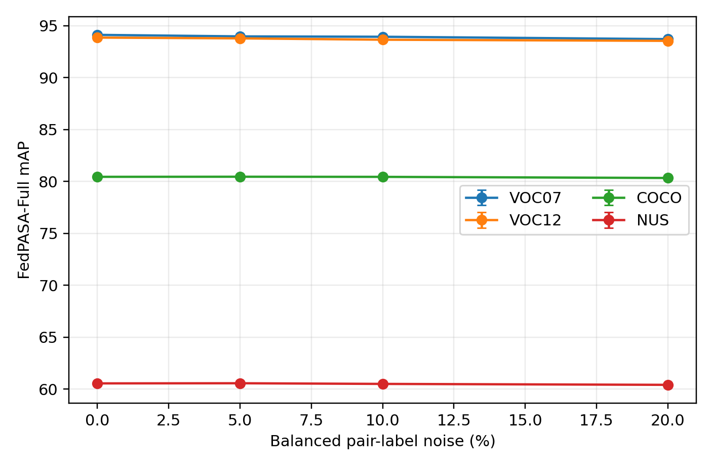
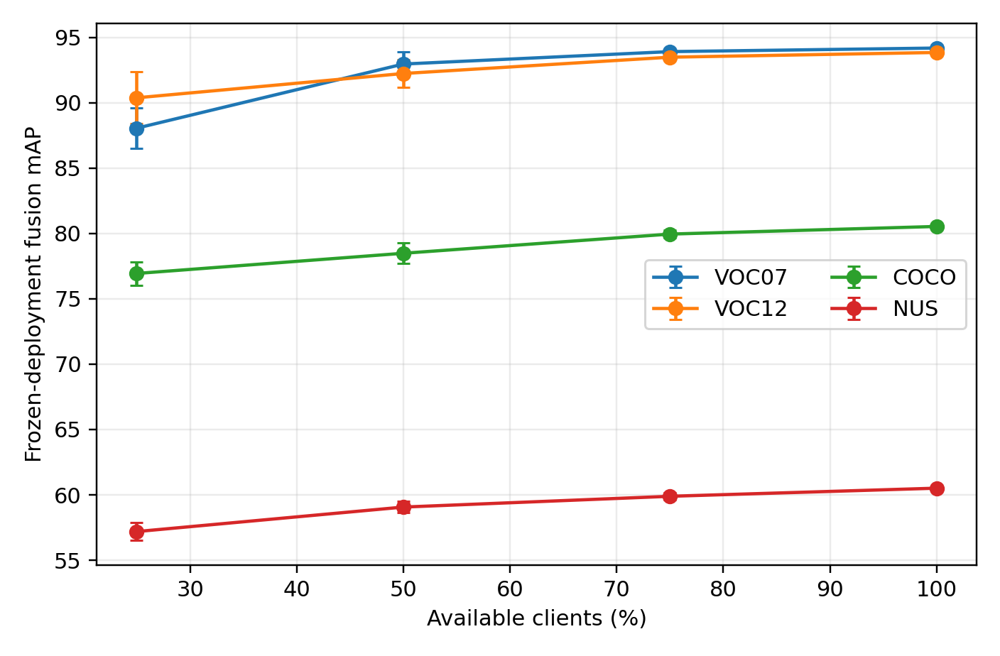
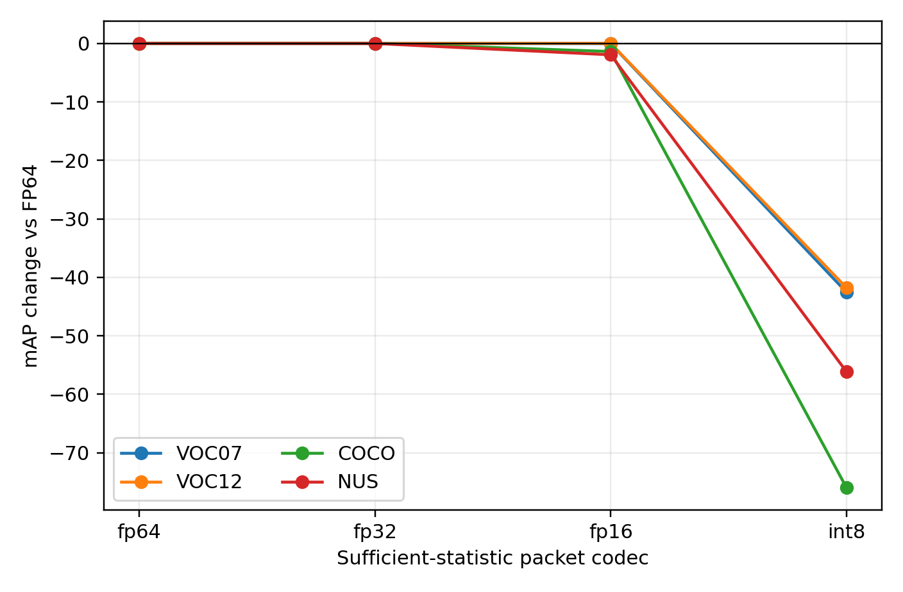
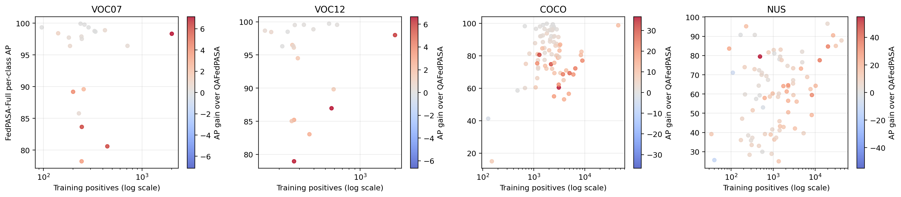
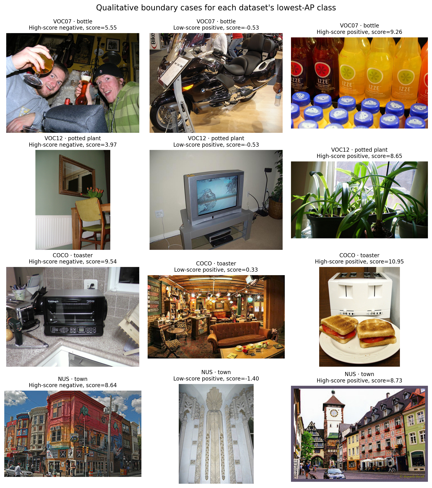

# FedPASA ICME 创新与全量实验交接文档

**状态：**99/99项补实验全部完成；最后一项于2026年10月29日17:36完成，最终结果见17.9。17.1至17.8保留此前98项快照，9月历史批次见第16节。

**锁定方法：**FedPASA-Full

**日期：**2026-10-29 全部99项完成交接

**工作区：**E:/FedPASA；前文 D:/project 路径为历史工作区

**主交付：**本Word及同名Markdown；新增结果及核对记录位于outputs/supplement_20261029。

运行交接：全部补实验已完成；17.9补齐最后一项连续TCP计时并更新最终状态。17.1至17.8中的待补描述仅指此前98项快照。新三候选FedAvg参考仍不替代历史充分调参比较。

|                                                                                                                                                                                                                 |
|-----------------------------------------------------------------------------------------------------------------------------------------------------------------------------------------------------------------|
| **一句话贡献** 将 PIAA 的集中式 patch 分类器估计改写为全局分位数对齐的联邦充分统计问题，并与多视图、闭式、标签感知联邦 Ridge 通过严格训练侧逐类别融合，形成无需迭代反向传播的多标签适配框架；拟合阶段采用联邦充分统计；第16节补充了传输样本级验证分数与标签的分布式校准及TCP实测，不声称端到端无样本信息传输。 |

# 0. 交接摘要

| **数据集** | **FedPASA-Full** | **最强公开外部** | **提升** | **95% bootstrap CI** |
|------------|------------------|------------------|----------|----------------------|
| VOC07      | 94.22            | 90.13            | +4.09    | \[93.71, 94.73\]     |
| VOC12      | 93.98            | n/a              | n/a      | \[93.50, 94.44\]     |
| COCO       | 80.53            | 67.37            | +13.16   | \[80.25, 80.83\]     |
| NUS-WIDE   | 60.67            | 58.36            | +2.31    | \[60.23, 61.70\]     |

|                                                                                                                                                                      |
|----------------------------------------------------------------------------------------------------------------------------------------------------------------------|
| **目标结论** 在 FedMPT Table 1 覆盖的 VOC07、COCO、NUS-WIDE 上，与公开最高值的最小数值差为 +2.31 mAP；它不是同协议受控增益，也不作为投稿验收目标。VOC12 没有对应联邦外部表项，只报告 93.98 mAP，不写 +2 结论。 |

当前机器验收器已将主实验、无测试集选参、96 行 estimator-preserving 对照、201 类互补性分析、通信拆分、官方基线审计、12 个定性样例以及 11 组 PNG/PDF 双格式图全部纳入；本地证据套件 `overall_pass = true`。该状态仅指历史套件；新增调参适配强基线及Full分布式校准见第16节。

## 阅读导航

-   第 1-2 节：从原始 PIAA 到最终锁定创新，明确哪些能写、哪些不能写。

-   第 3-6 节：所有支持创新点的主结果、消融、统计、鲁棒性、系统和失败分析。

-   第 7-9 节：完整实验登记、复现顺序、文件索引与后续写作动作。

# 1. 原始 PIAA 血统与问题定义

原始 PIAA 将多标签识别重写为 Patch-level Inference + Adaptive Aggregation。PVCL 从未标注 patch bank 估计类别均值与共享协方差，并用 GDA 闭式获得视觉分类器；PAA 再以固定 alpha=0.9 融合 patch 与 CLS 分数。原稿第 5-6 页给出 PVCL/PAA 公式，第 9 页 limitations 明确指出初始 patch 预测和 patch bank 的 noisy/biased 风险，并提出 reliability-aware calibration 作为未来方向。

<table><tbody><tr class="odd"><td>PIAA / GDA: w_c = Sigma^{-1} mu_c<br />
b_c = -0.5 * mu_c^T Sigma^{-1} mu_c<br />
PIAA / PAA: S_f,c = alpha * S_patch,c + (1-alpha) * S_cls,c, alpha=0.9</td></tr></tbody></table>

联邦场景放大了该风险：各客户端类别覆盖、patch 数量、纯度和目标尺度不同。若每个客户端独立取 K 个 patch 后再合并，会把集中式每类 K=512 的 bank 变成最多 K×clients 的偏置 bank；若直接平均分类器参数，也不能保证恢复集中式闭式解。

|                                                                                                                              |
|------------------------------------------------------------------------------------------------------------------------------|
| **切入点** 不是 PIAA + FedAvg，而是把集中式 patch distribution estimation 改造成可合并、可审计、无需传单样本的联邦充分统计。 |

# 2. 最终锁定的创新点

| **编号** | **名称**         | **核心机制**                                                   | **证据强度**                               |
|----------|------------------|----------------------------------------------------------------|--------------------------------------------|
| I1       | QAFedPASA        | 全局分位数对齐 + 四次统计上传；一致选样下恢复中央估计器（给定容差）             | 强；直接消融、central-equivalence、Non-IID |
| I2       | 多视图联邦 Ridge | CLS/patch mean/patch max-text 的标签感知闭式适配，仅传可加统计 | 强；特征消融、集中式等价、通信             |
| I3       | 逐类别双分支融合 | 训练侧 out-of-sample 校准与选权；三划分均值折叠为一次仿射评分  | 强；三种子、bootstrap、逐类增益            |
| S1       | 系统与协议性质   | 无迭代反向传播、拟合统计不传样本、Ridge FP32 近乎无损         | 支撑项；不是正式 DP 保证                   |

## 2.1 I1 - 全局分位数对齐的 QAFedPASA

客户端首先保留本地候选 patch，但只交换每类熵顺序统计量；服务器据此下发全局 top-K 配额。客户端随后上传初始 GDA moment packet；收到初始全局 GDA 后，再上传每类 {count, sum(q), sum(q^2)} 以构造全局 mean+sample-std 净化阈值；最后上传净化后的 GDA moments。共四次客户端上传，其中 sum(q^2) 不能由另两项重构。

<table><tbody><tr class="odd"><td>Upload 1: entropy order statistics -&gt; global per-class top-K quota<br />
Upload 2: {count, sum_x, mass, weighted_sum_x, second_moment} -&gt; preliminary GDA<br />
Upload 3: {count, sum(q), sum(q^2)} -&gt; global mean + sample-std threshold<br />
Upload 4: GDA moments after global purification -&gt; final GDA<br />
Default QAFed fitting uploads no image, label, patch identity or individual embedding.<br />Optional shared tie keys transmit patch IDs; Full calibration is outside this claim.</td></tr></tbody></table>

-   直接解决 local top-K bank 过大和客户端偏置，而不是依赖启发式模型平均。

-   统计量在同一选样总体下可加；恢复同一中央估计器要求一致的选样及边界 tie 规则，浮点计算按给定容差判断。默认协议不上传 patch ID，不能保证任意 tie 情况下选中相同 patch；可选 shared-key 协议额外上传 int64 patch ID，见第 11 节。

-   标签完全不进入 QAFedPASA bank 构建和适配器拟合。

### 2.1.1 投稿前实现—公式一致性核对（已闭环）

|                                                                                                                                                                                                    |
|----------------------------------------------------------------------------------------------------------------------------------------------------------------------------------------------------|
| **结论** 显式 PurificationPacket 是对既有计算的数据边界重构，不改变 purification threshold、保留 patch、最终 GDA 权重/偏置或 mAP；该次 PurificationPacket 重构只需修正协议轮数、通信口径和证据字段，无需重跑准确率；Full校准协议已于第16节补充。 |

实际 q_x 是客户端收到 preliminary global GDA 后，对已选 patch 计算的预测类别 refined confidence。由于 q_x 依赖该全局 GDA，它不能并入此前的 preliminary GDA moment packet；而 sum(q_x^2) 也不能由 count 与 sum(q_x) 重构。因此客户端必须在收到 preliminary GDA 后显式上传每类 {count, sum(q), sum(q^2)}。

<table><tbody><tr class="odd"><td>r_kc = |S_kc|, a_kc = sum_{x in S_kc} q_x, b_kc = sum_{x in S_kc} q_x^2<br />
r_c = sum_k r_kc, A_c = sum_k a_kc, B_c = sum_k b_kc<br />
theta_c = A_c/r_c + sqrt(max(B_c - A_c^2/r_c, 0)/(r_c-1)) # sample std<br />
Comm_up = 4M[CK + 2(D^2 + 2CD + 2C) + 3C] bytes # dense FP32 uplink</td></tr></tbody></table>

| **核对项** | **确认结果**                                                               | **对既有实验的影响**                                     |
|------------|----------------------------------------------------------------------------|----------------------------------------------------------|
| 数值路径   | 旧实现直接累加 count/sum(q)/sum(q^2)；新实现先形成客户端 packet 再逐项求和 | 逐位等价；阈值最大绝对差 0.0                             |
| 模型与指标 | 计算仍使用 float64；聚合公式、样本标准差及边界处理不变                     | 保留 patch、GDA weight/bias、AP/mAP 不变；无需重跑准确率 |
| 协议元数据 | 原文将 preliminary GDA 与其后才能计算的 q-moments 合并称为第 2 阶段        | 修正为 4 次客户端上传；仅记录和叙述变化                  |
| 通信量     | 旧公式已用 3C 计入 count/sum(q)/sum(q^2)，但没有独立命名                   | 总 MiB 不变；新增 purification_moments_MiB 分项        |

验证证据：随机多客户端旧/新阈值逐位相同（bitwise_equal=true，max_abs_diff=0.0）；核心测试 5/5 通过；投稿证据审计 overall_pass=true 且 communication_breakdown_exact=true。VOC07 的 t=60% 配置中，12 个客户端、20 类的独立净化 packet 仅为 0.0027466 MiB。

|                                                                                                                                                                                                                                                                             |
|-----------------------------------------------------------------------------------------------------------------------------------------------------------------------------------------------------------------------------------------------------------------------------|
| **通信口径** 当前表格统计 dense FP32 client-to-server uplink upper bound；代码中的实际统计聚合仍为 float64 联邦逻辑模拟。论文表头应写 Uplink communication。若未来真实序列化为 FP32 或统计双向通信，则必须另做数值回归并加入 quota、preliminary GDA、threshold 等下行载荷。 |

## 2.2 I2 - 多视图标签感知联邦 Ridge

为了利用训练标签但避免样本级传输，客户端对冻结图像特征构造 RidgePacket。服务器对 n、sum_x、sum_y、X^T X、X^T Y 求和，以 float64 解正规方程。特征视图为全局 CLS、patch mean 和对文本原型的 patch max 响应，三者互补。

<table><tbody><tr class="odd"><td>RidgePacket_k = {n_k, sum_x_k, sum_y_k, X_k^T X_k, X_k^T Y_k}<br />
W = (X_c^T X_c + lambda * scale * I)^{-1} X_c^T Y_c<br />
b = mean_y - mean_x * W</td></tr></tbody></table>

|                                                                                                                                                              |
|--------------------------------------------------------------------------------------------------------------------------------------------------------------|
| **术语边界** 该分支使用训练标签，因此 FedPASA-Full 应写成 label-aware, backpropagation-free closed-form federated adaptation；不能写成完全 annotation-free。 |

## 2.3 I3 - 无测试泄漏的逐类别融合

每个 seed 把训练集划分为 80% fit 与 20% validation。Ridge 与 PIAA 两个分支都只在 fit 子集拟合，再在 validation 上产生真正 out-of-sample 预测；按类别从 0.0-1.0 的 21 个权重中选取融合系数。三个 seed 的逐类别得分函数取平均后仍是单个仿射函数，可在部署时预先合并。

校准与通信边界：现有 run_label_patch_fusion.py 集中读取训练侧 validation 的逐样本预测与标签，计算校准参数及候选权重的 AP。GDA/Ridge 拟合已有充分统计量接口；本段为历史实现；分布式校准及TCP新增证据见第16节。因此，拟合阶段不传单样本的证据不能扩展为整个 Full 流程的端到端传输保证。现有通信表仅计超参数确定后的拟合统计上传，未包含三划分校准、选参、重拟合全过程及服务器下行成本。

<table><tbody><tr class="odd"><td>score_c(x) = a_c * z_ridge,c(x) + (1-a_c) * z_piaa,c(x)<br />
score_CV,c(x) = mean_seed score_seed,c(x) # still one affine class score<br />
Selection data: training-side validation only; test labels never used.</td></tr></tbody></table>

## 2.4 已验证但未锁定的早期方案

初始创新备忘提出 client-class entropy/consensus reliability weighting 与 empirical-Bayes personalized shrinkage。代码中对应 `fit_fedpasa()` / `fit_fedpasa_from_packets()`，但 `reliability_\*` 消融在四个数据集均弱于 quantile-aligned top-K=512。因此它们应作为探索性负结果或未来工作，不应继续作为最终主贡献。

| **数据集** | **QAFed top-K=512** | **reliability+shrinkage** | **差值** |
|------------|---------------------|---------------------------|----------|
| VOC07      | 92.53               | 90.20                     | -2.33    |
| VOC12      | 92.29               | 89.40                     | -2.89    |
| COCO       | 72.98               | 66.49                     | -6.49    |
| NUS-WIDE   | 50.62               | 47.25                     | -3.37    |

# 3. 实验协议与外部基线

| **项目**       | **锁定设置**                                                                                                                                |
|----------------|---------------------------------------------------------------------------------------------------------------------------------------------|
| 骨干/输入      | 冻结 CLIP ViT-B/16；PIAA/SC-CLIP patch 与 CLS 缓存                                                                                          |
| 数据集         | VOC07 20 类、VOC12 20 类、COCO 80 类、NUS-WIDE 81 类                                                                                        |
| 指标           | class-wise Average Precision 的均值 mAP (%)                                                                                                 |
| KMeans 划分    | 最终 ICME 流水线对 L2-normalized ViT-B/16 CLS 与文本特征的零样本概率向量做聚类；t={10,20,40,60,80,100}%，seeds={7,17,27}，n_init=10，Lloyd |
| Dirichlet 划分 | 原等价性实验 beta={0.1,0.3,0.5}、10 clients、3 seeds；naive 证据实验为相同 beta 加 KMeans、seed=7                                           |
| 选参           | 训练侧 80/20；Ridge alpha、分支校准、融合权重均不读 test label                                                                              |
| 外部结果       | FedMPT Table 1 的 11 个 published_external 方法；官方源码审计不能产生 author-equivalent controlled rerun，禁止把修复版诊断值写入准确率主表 |
| 主方法         | FedPASA-Full = QAFedPASA + multi-view federated Ridge + classwise CV fusion                                                                 |

|                                                                                                                                                          |
|----------------------------------------------------------------------------------------------------------------------------------------------------------|
| **比较范围** “超过最强外部基线约 2 点”只适用于 FedMPT 表中有可比数值的 VOC07、COCO、NUS-WIDE；不延伸到 VOC12，也不延伸到不同监督级别的集中式全监督模型。 |

## 3.1 四类可复现性与实验协议核对（投稿锁定版）

|                                                                                                                                                                                                                                                                                                            |
|------------------------------------------------------------------------------------------------------------------------------------------------------------------------------------------------------------------------------------------------------------------------------------------------------------|
| **核对结论** 数据划分、Ridge、QAFed/Patch 与鲁棒性四类信息均已从最终结果文件及其生成脚本回查。现有结果不需要因为补写这些参数而重跑；其中客户端参与率实验本身已经包含 101/202/303 三个预声明子集种子。只有当论文改称“每轮重新采样客户端”或“逐标签独立 Bernoulli 噪声”时，才会与当前实现不一致并需要新实验。 |

### 3.1.1 数据划分与随机性设置

最终 ICME 多数据集协议以 `scripts/run_icme_experiments.py` 和各数据集 `main.json` 为准。先分别 L2 归一化冻结的 CLIP ViT-B/16 全局 CLS 特征与单模板文本特征，再计算 q_i=softmax(z_i T^T)，得到每幅训练图像的 C 维零样本类别概率向量。K-means 直接作用于 q_i：没有使用标签、没有 PCA，也没有额外 logit temperature。

<table><tbody><tr class="odd"><td>partition_feature_i = softmax(L2(cls_i) @ L2(text)^T) # C-dimensional<br />
KMeans(n_clusters=N, init='k-means++', n_init=10, algorithm='lloyd', random_state=seed)<br />
partition seeds = {7, 17, 27}; feature extraction DataLoader shuffle=False</td></tr></tbody></table>

| **数据集** | **类别 C** | **t=10/20/40/60/80/100% 的客户端数** | **partition seeds** | **runs** |
|------------|------------|--------------------------------------|---------------------|----------|
| VOC07      | 20         | 2/4/8/12/16/20                       | 7/17/27             | 18       |
| VOC12      | 20         | 2/4/8/12/16/20                       | 7/17/27             | 18       |
| COCO       | 80         | 8/16/32/48/64/80                     | 7/17/27             | 18       |
| NUS-WIDE   | 81         | 8/16/32/49/65/81                     | 7/17/27             | 18       |

客户端数由 max(2, round(C×t)) 得到。`init` 未在构造器中显式传入，因而采用 scikit-learn KMeans 的默认 `k-means++`；`n_init=10` 与 `algorithm='lloyd'` 是显式锁定项。旧脚本 `scripts/run_voc07_fedpasa.py` 曾直接对归一化 CLS 聚类并使用 n_init=20，但它是遗留的 VOC-only 路径，不是本文最终多数据集主结果协议，投稿文字不得混用。

### 3.1.2 Ridge baseline 的超参数与选择规则

最终 Ridge 输入为 `cls + patch_mean + patch_max_text`：CLS 与 patch mean 各 512 维，patch max-text 为 C 维；拼接完成后对整条向量做一次 L2 归一化。每个客户端只上传 {n, sum_x, sum_y, X^T X, X^T Y}，服务器在 float64 中聚合并求解带截距的中心化正规方程。这里的 lambda 是按训练特征能量缩放的系数，不等同于未经缩放的 sklearn Ridge alpha。

<table><tbody><tr class="odd"><td>scale = trace(X_centered^T X_centered) / D<br />
W = (X_centered^T X_centered + lambda * scale * I)^(-1) X_centered^T Y_centered<br />
lambda grid = {1e-4, 3e-4, 1e-3, 3e-3, 1e-2, 3e-2, 1e-1}</td></tr></tbody></table>

| **数据集** | **seed 7 选中 lambda** | **seed 17 选中 lambda** | **seed 27 选中 lambda** |
|------------|------------------------|-------------------------|-------------------------|
| VOC07      | 0.03                   | 0.03                    | 0.03                    |
| VOC12      | 0.10                   | 0.10                    | 0.03                    |
| COCO       | 0.0001                 | 0.0001                  | 0.0001                  |
| NUS-WIDE   | 0.0001                 | 0.0001                  | 0.0001                  |

对每个 seed，`np.random.default_rng(seed).permutation` 将训练集随机分为 80% fit/20% validation；lambda 按 validation mAP 最大值独立选择，随后用所选 lambda 在完整训练集上重拟合，测试标签从不参与选择。三视图先拼接后共用一个 lambda，并非每个视图单独设正则。特征消融使用 split seed=2026，并对每个视图组合单独选 lambda。需要特别注意：`run_label_ridge.py` 当前解析器默认网格仍是较旧的 {0.01,...,10}，最终结果实际使用的是上面的七点小正则网格；论文与复现命令必须显式传 `--alphas`，不能依赖脚本默认值。

FedPASA-Full 的融合选择同样只读训练侧 validation：Ridge 与 QAFedPASA 都在不含 validation 图像的 80% fit 上拟合；两分支分别按类别用 validation 预测的均值/标准差做 z-score（std 下限 1e-6），再从 0.00 到 1.00、步长 0.05 的 21 个 Ridge 权重中逐类别选择。三组 seed 的最终逐类得分取平均。

### 3.1.3 QAFedPASA / Patch 分支的具体实现参数

| **实现项**        | **投稿锁定设置**                                                                                                                                                                        |
|-------------------|-----------------------------------------------------------------------------------------------------------------------------------------------------------------------------------------|
| 冻结骨干          | OpenAI-style CLIP ViT-B/16 提取全局 CLS；PIAA 的 SC-CLIP ViT-B/16 分支提取 patch token；同一 `ViT-B-16.pt`，SHA256=5806e77c...88df416f                                                |
| 输入与 patch      | 官方 CLIP preprocess，224×224；patch size=16，因此每图 14×14=196 个 patch token，每个 512 维；缓存为 float16，计算时转 float32 并 L2 归一化                                             |
| Prompt            | 每类仅一个模板：`a photo of a {class_name}`；无 prompt ensemble                                                                                                                      |
| 初始置信度/候选   | logit=x·text；confidence=softmax(60×logit)，不是 sigmoid/raw logit；按 argmax 类别分组，每类保留最低 entropy 的全局 Top-K，K=512                                                        |
| 全局估计          | QAFed 用局部候选和全局分位数对齐恢复 Top-K；同一选样总体要求一致的边界 tie 规则；GDA 使用原始 softmax 类别置信度加权原型、合并 full covariance 与 trace shrinkage                                            |
| Purification      | 初步 GDA 后 refined=softmax(T_pur×logits)；q 为预测类别 refined confidence；每类阈值为全局 mean(q)+unbiased sample std(q)，由显式 {count,sum_q,sum_q2} packet 聚合；保留 q≥threshold |
| Patch aggregation | 最终每个 patch 先计算 softmax((xW+b)/500)，再对 196 个 patch 按类别取 max，最后 softmax(patch_scale×max)；不是 mean pooling                                                            |
| 固定分支融合      | QAFedPASA 分支内部为 0.1×CLS probability + 0.9×patch probability；entropy-adaptive 融合只做过消融，未用于最终结果                                                                       |
| Full 校准         | QAFed 内部尺度为固定 PIAA 参数；与 Ridge 组成 FedPASA-Full 时，才使用训练侧 validation 的逐类 z-score 与逐类融合权重                                                                    |

| **数据集** | **purification T_pur** | **CLS scale** | **patch scale** |
|------------|-------------------------|---------------|-----------------|
| VOC07      | 100                     | 80            | 200             |
| VOC12      | 100                     | 80            | 200             |
| COCO       | 0.01                    | 80            | 400             |
| NUS-WIDE   | 500                     | 10            | 400             |

温度敏感性实验只围绕上述数据集基准值乘以 {0.25,0.5,1,2,4}，不读取测试标签选点。净化阈值、四次客户端上传与 `PurificationPacket` 的公式—实现一致性详见 2.1.1；这次显式 packet 重构保持阈值逐位一致，因此不会改变已报告的 patch、adapter、AP 或 mAP。

### 3.1.4 鲁棒性实验：label noise 与 client participation

Label noise 采用 `balanced_pair_noise`，不是每个 multi-label 位独立 Bernoulli 翻转。对每个类别 c，在整个训练集的正样本和负样本中分别无放回抽取 m_c=min(round(rho×n_c^+), n_c^-) 个，将所选正标签置 0、等量负标签置 1，因此每类正例数严格不变。噪声率为 {0,5,10,20}%，基础 seeds={7,17,27}，实际 RNG seed=seed×100000+round(rho×10000)。每个 dataset/rate/seed 只生成一张全局训练标签噪声矩阵，再按既定数据使用；不是每客户端独立重新加噪。

噪声条件下，Ridge lambda 与融合权重仍只用干净的训练侧 20% validation 标签选择；选中 lambda 后在全部带噪训练标注上重拟合。QAFedPASA 为 label-free 分支，保持固定。最终均值/样本标准差来自三个 seeds，test label 不参与调参。

<table><tbody><tr class="odd"><td>m_c = min(round(rho * positives_c), negatives_c)<br />
choose m_c positives without replacement: 1 -&gt; 0<br />
choose m_c negatives without replacement: 0 -&gt; 1 # prevalence preserved per class</td></tr></tbody></table>

Client participation 使用固定的 t=40%、partition seed=7 的 K-means 划分作为母划分：VOC07/VOC12 各 8 个客户端，COCO/NUS-WIDE 各 32 个。请求比例为 {25,50,75,100}%；每个条件在聚合/重拟合前，以 uniform sampling without replacement 一次性选择 max(1,round(fraction×N)) 个客户端。subset seeds={101,202,303}，实际 RNG seed=subset_seed+10000×N+round(100×fraction)。同一子集同时用于 QAFedPASA 与 Ridge；不存在逐轮重新采样，因为当前方法是一次性充分统计聚合/闭式拟合而非迭代训练。

| **数据集** | **母客户端数** | **25% 实际选中 ID**                                                          | **75% 实际排除 ID**                                                           | **训练图像保留率范围：25% / 75%** |
|------------|----------------|------------------------------------------------------------------------------|-------------------------------------------------------------------------------|-----------------------------------|
| VOC07      | 8              | 101:1/7; 202:4/7; 303:0/6                                                    | 101:3/4; 202:4/7; 303:2/7                                                     | 18.66-24.73 / 75.17-82.20         |
| VOC12      | 8              | 101:1/7; 202:4/7; 303:0/6                                                    | 101:3/4; 202:4/7; 303:2/7                                                     | 22.44-39.23 / 77.37-80.92         |
| COCO       | 32             | 101:2/7/13/14/22/29/30/31; 202:5/7/10/19/24/25/27/28; 303:2/4/6/7/9/11/21/26 | 101:1/3/8/10/17/25/27/30; 202:0/3/6/7/13/19/20/29; 303:2/10/11/20/22/23/27/30 | 25.20-28.08 / 74.67-76.77         |
| NUS-WIDE   | 32             | 101:2/7/13/14/22/29/30/31; 202:5/7/10/19/24/25/27/28; 303:2/4/6/7/9/11/21/26 | 101:1/3/8/10/17/25/27/30; 202:0/3/6/7/13/19/20/29; 303:2/10/11/20/22/23/27/30 | 22.71-26.17 / 70.39-78.21         |

表中 75% 为节省篇幅列出“排除 ID”；其余客户端即实际参与集合。K-means 客户端大小不均衡，所以客户端比例不等于训练图像保留比例，结果文件同时记录两者。Ridge lambda、两分支逐类校准参数和逐类融合权重均在 availability shock 之前冻结自 seed-7 训练侧 validation，不针对任何参与率条件重调；100% 条件三个子集种子得到同一完整集合，故标准差为 0。全部 25/50/75/100% 的逐条件集合与结果保存在 `outputs/icme/paper/client_participation.json`。

| **核对项**           | **是否补跑** | **原因/投稿边界**                                                             |
|----------------------|--------------|-------------------------------------------------------------------------------|
| 数据划分/K-means     | 无需         | 参数与 72 个主实验 run 已写入 main.json；只需准确补文                         |
| Ridge                | 无需         | 实际网格、split seed 与每 seed 选中 lambda 均已有结果证据                     |
| QAFed/Patch          | 无需         | 实现参数已锁定；显式 PurificationPacket 与旧阈值逐位相同                      |
| Label noise          | 无需         | 0/5/10/20% × 3 seeds 已完成；正文必须称 prevalence-preserving paired flips    |
| Client participation | 无需         | 25/50/75/100% × 3 subset seeds 已完成；正文必须称 one-shot availability shock |

## 3.2 ICME 主文 SOTA 表：单值、三数据集、六个代表方法

主文不再并列“baseline 范围”与“FedPASA 单点”。对每个已发表方法，统一取其 t=10%-100% 公开结果中的最高 mAP；这样仅避免选取外部方法较低的公开值，不能消除协议差异。主文仅保留 2024-2026 年的六个代表方法，删除没有外部可比项的 VOC12 列，并显式给出相对最强公开方法 FedMPT 的 Gain。

| **Method**         | **VOC07**    | **COCO**     | **NUS-WIDE** |
|--------------------|--------------|--------------|--------------|
| FedPGP             | 85.47        | 63.10        | 55.92        |
| FedTPG             | 88.11        | 63.91        | 53.01        |
| FedAWA             | 84.75        | 65.58        | 54.67        |
| Fed-RAM            | 88.05        | 66.06        | 56.35        |
| FedMVP             | 87.14        | 65.76        | 53.32        |
| FedMPT             | <u>90.13</u> | <u>67.37</u> | <u>58.36</u> |
| **FedPASA (Ours)** | **94.22**    | **80.53**    | **60.67**    |
| **Gain**           | **+4.09**    | **+13.16**   | **+2.31**    |

|                                                                                                                                                                                                                                                                                          |
|------------------------------------------------------------------------------------------------------------------------------------------------------------------------------------------------------------------------------------------------------------------------------------------|
| **主表视觉规则** 按 ICME/IEEE 常见紧凑表格处理：使用单栏 table\[t\]、lccc、small、tabcolsep=4.5pt，不画竖线；最佳结果加粗，第二名（FedMPT）数值加下划线，Gain 行加粗。caption 必须说明：For methods reported under multiple settings, we conservatively use their best published result. |

## 3.3 VOC12 与组件表的安排

VOC12 不从论文删除，但不进入 Published Federated SOTA Comparison。主结果表后紧接以下英文说明；四数据集结果继续保留在 component analysis、overall results、鲁棒性和消融表中。

<table><tbody><tr class="odd"><td>FedPASA further achieves 93.98 mAP on VOC12; we report this<br />
result for completeness but exclude it from the direct SOTA comparison<br />
because the adopted published federated benchmark does not provide a<br />
corresponding VOC12 entry.</td></tr></tbody></table>

| **Variant**             | **VOC07** | **VOC12** | **COCO**  | **NUS-WIDE** |
|-------------------------|-----------|-----------|-----------|--------------|
| w/o Quantile Alignment  | 88.94     | 88.18     | 65.80     | 46.85        |
| w/o Global Purification | 92.53     | 92.29     | 67.63     | 50.61        |
| Diagonal Covariance     | 91.71     | 91.30     | 73.32     | 50.40        |
| QAFedPASA               | 92.53     | 92.29     | 72.98     | 50.62        |
| Ridge (CLS only)        | 91.81     | 91.40     | 76.12     | 58.41        |
| Ridge (Three Views)     | 94.03     | 93.69     | 79.83     | 60.19        |
| **FedPASA-Full**        | **94.22** | **93.98** | **80.53** | **60.67**    |

该组件表不是外部 SOTA 横向表，因此保留 VOC12 合理；它同时把 QAFedPASA、三视图 Ridge 与逐类别融合的贡献放在同一统一口径下。四数据集宽表可继续使用双栏 table\*\[t\]，同样不使用竖线。

## 3.4 补充材料：全部 11 个公开外部基线

| **方法**                    | **VOC07 范围** | **COCO 范围** | **NUS 范围** |
|-----------------------------|----------------|---------------|--------------|
| Fed-DualCoOp (NeurIPS 2022) | 82.02-87.67    | 51.46-61.88   | 39.40-51.02  |
| Fed-SCPNet (CVPR 2023)      | 76.48-83.37    | 46.67-60.96   | 38.49-49.56  |
| Fed-MaPLe (CVPR 2023)       | 76.08-87.87    | 47.24-64.83   | 50.98-54.78  |
| FedPGP (ICML 2024)          | 76.60-85.47    | 54.53-63.10   | 43.20-55.92  |
| Fed-TCP (CVPR 2024)         | 76.42-81.56    | 57.22-62.79   | 47.20-54.46  |
| FedTPG (ICLR 2024)          | 82.72-88.11    | 50.88-63.91   | 49.46-53.01  |
| Fed-PosCoOp (WACV 2025)     | 79.90-87.42    | 50.02-63.28   | 40.08-52.88  |
| FedAWA (CVPR 2025)          | 78.22-84.75    | 57.57-65.58   | 50.40-54.67  |
| Fed-RAM (CVPR 2025)         | 83.04-88.05    | 55.64-66.06   | 51.20-56.35  |
| FedMVP (ICCV 2025)          | 82.43-87.14    | 58.48-65.76   | 51.08-53.32  |
| FedMPT (CVPR 2026)          | 87.19-90.13    | 62.37-67.37   | 54.87-58.36  |

*本表仅作为 supplementary full comparison 的交接底稿：范围为 t=10%-100% 的最小-最大 mAP；完整逐 t 数字在 `outputs/icme/paper/main_comparison.csv`。不得再把这些范围直接复制回 ICME 主表。*

## 3.5 同协议外部 baseline 的实际状态

| **方法组**    | **已完成**                       | **阻塞**                                 | **交接口径**                       |
|---------------|----------------------------------|------------------------------------------|------------------------------------|
| FedMPT        | VOC 1 轮诊断；COCO/NUS 修补版各 200 轮完成 | 需要改变预测语义的修复                   | 不能作为 controlled accuracy rerun |
| FedMVP/FedAWA | FedMVP 适配版六组完成 | 适配差异见第 13 节；FedAWA 未训练 | FedMVP 完成 |
| FedPGP/FedTPG | 源码存在于同一 benchmark         | 共享数据/协议缺陷，未完成 3 seeds 全训练 | 未完成                             |

|                                                                                                                                                                                                                     |
|---------------------------------------------------------------------------------------------------------------------------------------------------------------------------------------------------------------------|
| **P0-1 边界** 9 月 7 日服务器交接已记录 COCO/NUS 图像核验；早期仅有 VOC/COCO 诊断数据的说明已过时。FedMPT benchmark 无 VOC12 入口，官方等价三基线复现仍未完成。补充 S01 的修补版 COCO/NUS 已完成 200 轮，分别为 69.806/35.824 mAP；最终结果已核验归档；Full 分布式校准协议另有证据缺口。 |

# 4. 支撑 I1 的实验：全局恢复、消融与 Non-IID

## 4.1 K 与关键组件消融

| **数据集** | **K=128** | **K=256** | **K=512** | **K=1024** |
|------------|-----------|-----------|-----------|------------|
| VOC07      | 90.13     | 91.58     | 92.53     | 91.73      |
| VOC12      | 89.17     | 90.92     | 92.29     | 91.57      |
| COCO       | 66.49     | 67.27     | 72.98     | 72.15      |
| NUS-WIDE   | 45.95     | 48.95     | 50.62     | 49.71      |

| **数据集** | **完整** | **无分位数对齐** | **对齐增益** | **无全局净化** | **对角协方差** |
|------------|----------|------------------|--------------|----------------|----------------|
| VOC07      | 92.53    | 88.94            | +3.58        | 92.53          | 91.71          |
| VOC12      | 92.29    | 88.18            | +4.11        | 92.29          | 91.30          |
| COCO       | 72.98    | 65.80            | +7.19        | 67.63          | 73.32          |
| NUS-WIDE   | 50.62    | 46.85            | +3.77        | 50.61          | 50.40          |

K=512 在四个数据集均最优。Quantile alignment 是一致且幅度最大的关键消融。全局净化在 COCO 上贡献显著，但在 VOC/NUS 上接近中性；对角协方差在 COCO 略高、其余数据集略低，不能写成所有数据集一致增益。

**图 1 QAFedPASA 关键消融（源：paper/ablation.csv）**



## 4.2 KMeans 客户端规模与集中式等价

| **数据集** | **runs** | **clients** | **mAP 范围**      | **最大权重误差** | **通信 MiB** |
|------------|----------|-------------|-------------------|------------------|--------------|
| VOC07      | 18       | 2-20        | 92.52867-92.52867 | 3.81e-06         | 4.39-43.92   |
| VOC12      | 18       | 2-20        | 92.28735-92.28735 | 4.77e-07         | 4.39-43.92   |
| COCO       | 18       | 8-80        | 72.98428-72.98428 | 7.63e-06         | 22.27-222.67 |
| NUS-WIDE   | 18       | 8-81        | 50.62047-50.62047 | 9.54e-07         | 22.35-226.25 |

72 个主实验配置的参数恢复检查均在登记容差内通过；其中 mAP 按 main.json 的 score_provenance 在参数检查后复用代表性完整测试结果，并非 72 次独立测试。该证据支持给定选样条件下的 central-equivalence；客户端缺失造成的退化见第 6.2 节。

**图 2 外部基线与客户端规模异质性对比**



## 4.3 Dirichlet 强 Non-IID

| **数据集** | **beta**    | **runs** | **mAP**  | **最大权重误差** | **等价** |
|------------|-------------|----------|----------|------------------|----------|
| VOC07      | 0.1/0.3/0.5 | 9        | 92.52867 | 3.81e-06         | True     |
| VOC12      | 0.1/0.3/0.5 | 9        | 92.28735 | 1.91e-06         | True     |
| COCO       | 0.1/0.3/0.5 | 9        | 72.98428 | 7.63e-06         | True     |
| NUS-WIDE   | 0.1/0.3/0.5 | 9        | 50.62047 | 9.54e-07         | True     |

## 4.4 Naive federation 与 estimator-preserving federation

| **数据集** | **划分** | **Naive-A** | **Naive-B** | **FedPASA** | **记录误差*** |
|------------|----------|-------------|-------------|-------------|-------------------|
| COCO       | beta=0.1 | 67.32       | 73.38       | 72.98       | 0.0e+00           |
| COCO       | beta=0.3 | 67.42       | 73.34       | 72.98       | 0.0e+00           |
| COCO       | beta=0.5 | 67.41       | 73.52       | 72.98       | 0.0e+00           |
| COCO       | KMeans   | 66.92       | 71.31       | 72.98       | 0.0e+00           |
| NUS-WIDE   | beta=0.1 | 47.13       | 50.66       | 50.62       | 0.0e+00           |
| NUS-WIDE   | beta=0.3 | 47.16       | 50.77       | 50.62       | 0.0e+00           |
| NUS-WIDE   | beta=0.5 | 47.19       | 50.82       | 50.62       | 0.0e+00           |
| NUS-WIDE   | KMeans   | 47.20       | 50.12       | 50.62       | 0.0e+00           |

四数据集 × 4 划分 × 6 方法共 96 行。表中记录误差为 0.0e+00 的 16 行 QAFedPASA 结果，均在权重和偏置误差不超过 1e-5 后复用中央预测；该零值不是独立推理的误差测量。来源：run_reviewer_evidence.py 的复用分支及 estimator_preserving_evidence.json 的 score_provenance。Naive 方法最大相对权重误差为 0.909；patch-ID recall 为 98.350%-99.961%，不能将不同 ID 自动视为等价替换。独立推理证据见第 11 节的 supplementary/estimator_mismatch.csv 与 federation_gap.csv；这些实验的条件与旧表不同，不互换数值。

Naive-A 为 local Top-K union 后 pooled solve；Naive-B 为 sample-weighted local GDA 参数平均；Naive-C 为 sample-weighted local Ridge 参数平均。为避免利用数值崩溃夸大差距，naive PIAA 的 mean+std 净化阈值在饱和 tie 时保守夹到该类观测最大值。

**图 3 Naive local-union 与 FedPASA 的 Non-IID estimator 证据**



# 5. 支撑 I2/I3 的实验：多视图闭式适配与融合

## 5.1 七种冻结特征组合

| **特征**                         | **VOC07** | **VOC12** | **COCO** | **NUS** |
|----------------------------------|-----------|-----------|----------|---------|
| cls                              | 91.81     | 91.40     | 76.12    | 58.41   |
| patch_mean                      | 90.19     | 90.23     | 71.06    | 54.23   |
| patch_max_text                 | 91.99     | 91.96     | 73.90    | 51.39   |
| cls+patch_mean                  | 92.81     | 92.54     | 77.85    | 59.78   |
| cls+patch_max_text             | 93.80     | 93.40     | 78.85    | 59.23   |
| patch_mean+patch_max_text     | 93.76     | 93.57     | 77.49    | 56.90   |
| cls+patch_mean+patch_max_text | 94.03     | 93.69     | 79.83    | 60.19   |

三视图 `cls+patch_mean+patch_max_text` 在 VOC07、VOC12、COCO 最优，并在 NUS 上接近最优；其选定 alpha 和完整验证分数保存在 `label_feature_ablation.csv`。

## 5.2 联邦 Ridge 与集中式闭式解一致

| **数据集** | **clients** | **集中式 mAP** | **联邦 mAP** | **最大分数误差** | **拟合上传 MiB*** |
|------------|-------------|----------------|--------------|------------------|------------------|
| VOC07      | 12          | 94.03261       | 94.03261     | 5.96e-08         | 128.15           |
| VOC12      | 12          | 93.65172       | 93.65172     | 0.00e+00         | 128.15           |
| COCO       | 48          | 79.82984       | 79.82984     | 2.38e-07         | 612.72           |
| NUS-WIDE   | 49          | 60.19301       | 60.19301     | 1.19e-07         | 627.24           |

本节核验 seed=17 的最终 Ridge 拟合：四数据集 mAP 绝对误差均为 0，最大测试分数误差 2.38e-7。组合通信仅计最终拟合统计上传，采用 QA FP32 + Ridge FP64；Full 校准/选参未计入。

| **数据集** | **Quantile** | **GDA moments** | **Ridge FP64** | **拟合上传 MiB*** |
|------------|--------------|-----------------|-----------------|---------------|
| VOC07      | 0.47         | 25.88           | 101.80          | 128.15        |
| VOC12      | 0.47         | 25.88           | 101.80          | 128.15        |
| COCO       | 7.50         | 126.10          | 479.12          | 612.72        |
| NUS-WIDE   | 7.75         | 129.11          | 490.37          | 627.24        |

| **数据集** | **clients** | **client bank s** | **ridge packet s** | **condition wall s** |
|------------|-------------|-------------------|--------------------|----------------------|
| VOC07      | 10          | 8.81              | 0.14               | 31.24                |
| VOC12      | 10          | 10.22             | 0.16               | 29.35                |
| COCO       | 10          | 310.65            | 1.86               | 387.08               |
| NUS-WIDE   | 10          | 230.16            | 2.81               | 311.72               |

本表是超参数已确定后的拟合统计上传量：QAFedPASA 为 4 次上传，按 FP32 dense upper bound 计量；Ridge 为 1 次上传，按 FP64 参考口径计量。COCO/NUS 合计 612.72/627.24 MiB；若 Ridge 也按 FP32 传输口径计量，则为 373.16/382.05 MiB，见第 11 节 S07。这些总量不包含三划分校准、选参及全部重拟合成本，也不包含服务器下行。运行时来自 10-client KMeans evidence condition，客户端在单机顺序模拟。

## 5.3 三训练划分与 bootstrap

| **数据集** | **3 seed mAP**    | **seed std** | **CV 聚合** | **95% bootstrap CI** |
|------------|-------------------|--------------|-------------|----------------------|
| VOC07      | 94.07/94.12/94.19 | 0.057        | 94.22       | \[93.71, 94.73\]     |
| VOC12      | 93.83/93.91/93.85 | 0.042        | 93.98       | \[93.50, 94.44\]     |
| COCO       | 80.36/80.46/80.54 | 0.089        | 80.53       | \[80.25, 80.83\]     |
| NUS-WIDE   | 60.69/60.45/60.51 | 0.122        | 60.67       | \[60.23, 61.70\]     |

每个数据集 1000 次 image-level bootstrap，seed=2026。VOC07/COCO 对所有 t 的 P(margin&gt;2)=1；NUS 在最强 t10 基线上为 0.929，其余 t 为 1.0。外部基线没有方差，因此该概率条件于公开 mAP 标量。

## 5.4 QAFedPASA 到 FedPASA-Full 的增益

| **数据集** | **QAFedPASA** | **FedPASA-Full** | **融合增益** |
|------------|---------------|------------------|--------------|
| VOC07      | 92.53         | 94.22            | +1.69        |
| VOC12      | 92.29         | 93.98            | +1.70        |
| COCO       | 72.98         | 80.53            | +7.54        |
| NUS-WIDE   | 50.62         | 60.67            | +10.05       |

## 5.5 Ridge-only 与 QAFedPASA 的逐类互补

| **数据集** | **Full&gt;Ridge** | **Full≈Ridge** | **Full&lt;Ridge** | **正增益均值** |
|------------|-------------------|----------------|-------------------|----------------|
| VOC07      | 12                | 4              | 4                 | 0.51           |
| VOC12      | 15                | 2              | 3                 | 0.44           |
| COCO       | 59                | 18             | 3                 | 0.96           |
| NUS-WIDE   | 42                | 19             | 20                | 1.06           |

| **数据集** | **Ridge** | **global fusion** | **classwise full** | **classwise-global** |
|------------|-----------|-------------------|--------------------|----------------------|
| VOC07      | 94.03     | 94.31             | 94.22              | -0.09                |
| VOC12      | 93.69     | 93.98             | 93.98              | +0.00                |
| COCO       | 79.83     | 80.28             | 80.53              | +0.25                |
| NUS-WIDE   | 60.19     | 60.33             | 60.67              | +0.34                |

COCO 有 59/80 类明确受益、平均正增益 0.96 AP；NUS-WIDE 有 42/81 类受益、平均正增益 1.06 AP。互补不是逐类单调：NUS 有 20 类下降，VOC07 的 global fusion 还比 classwise 高 0.09 mAP，均应如实保留。核心结论是 QAFedPASA 在 Ridge 失效的部分类别提供补充证据，而不是保证所有类别提高。

**图 4 COCO/NUS-WIDE 的 Full-Ridge 逐类 AP 差**



# 6. 鲁棒性、系统与失败分析

## 6.1 缺失正标签（60 个原始配置）

| **缺失率** | **VOC07** | **VOC12** | **COCO** | **NUS** |
|------------|-----------|-----------|----------|---------|
| 10%        | 93.97     | 93.82     | 80.24    | 60.25   |
| 30%        | 93.80     | 93.52     | 80.11    | 60.21   |
| 50%        | 93.20     | 92.72     | 79.78    | 59.99   |
| 70%        | 93.01     | 92.57     | 79.57    | 59.67   |
| 90%        | 90.99     | 92.37     | 77.92    | 56.17   |

表中为 3 seed 全局融合均值。90% 正标签缺失时仍为 90.99/92.37/77.92/56.17 mAP。QAFedPASA 分支理论上不读取训练标签，`annotation_mask_invariance.csv` 只记录该解析不变性，不把它伪装成额外经验运行。

**图 5 不完整正标签鲁棒性**



## 6.2 成对标签噪声与客户端参与率

| **pair noise** | **VOC07**  | **VOC12**  | **COCO**   | **NUS**    |
|----------------|------------|------------|------------|------------|
| 0%             | 94.30±0.01 | 93.93±0.06 | 80.28±0.02 | 60.32±0.01 |
| 5%             | 94.16±0.01 | 93.88±0.01 | 80.25±0.03 | 60.32±0.01 |
| 10%            | 94.11±0.03 | 93.74±0.08 | 80.23±0.03 | 60.30±0.04 |
| 20%            | 93.86±0.08 | 93.61±0.08 | 80.14±0.01 | 60.24±0.11 |

| **可用客户端** | **VOC07**  | **VOC12**  | **COCO**   | **NUS**    |
|----------------|------------|------------|------------|------------|
| 25%            | 88.06±1.53 | 90.38±1.99 | 76.94±0.90 | 57.19±0.67 |
| 50%            | 92.96±0.94 | 92.24±1.05 | 78.48±0.79 | 59.07±0.44 |
| 75%            | 93.91±0.06 | 93.49±0.10 | 79.95±0.30 | 59.89±0.29 |
| 100%           | 94.19±0.00 | 93.85±0.00 | 80.54±0.00 | 60.51±0.00 |

20% 标签噪声下结果仍稳定；75% 客户端可用时仅小幅下降。25% 可用时 VOC07/NUS 方差与下降明显，应作为部署下限而非稳健性亮点。所有融合/校准参数在参与率冲击前冻结。

**图 6 成对标签噪声鲁棒性**



**图 7 客户端参与率压力测试**



## 6.3 净化温度敏感性

| **数据集** | **倍率**             | **min** | **max** | **range** |
|------------|----------------------|---------|---------|-----------|
| VOC07      | 0.25/0.5/1.0/2.0/4.0 | 92.5287 | 92.5287 | 0.0000    |
| VOC12      | 0.25/0.5/1.0/2.0/4.0 | 92.2874 | 92.2874 | 0.0000    |
| COCO       | 0.25/0.5/1.0/2.0/4.0 | 72.9733 | 73.0132 | 0.0398    |
| NUS-WIDE   | 0.25/0.5/1.0/2.0/4.0 | 50.6205 | 50.6205 | 0.0000    |

*温度最大变化仅 0.04 mAP。投稿主文优先使用图 3 的 naive-vs-FedPASA 证据，本表和原温度图移至补充材料。*

## 6.4 通信压缩与系统边界

| **codec** | **平均压缩比** | **VOC07 Δ** | **VOC12 Δ** | **COCO Δ** | **NUS Δ** |
|-----------|----------------|-------------|-------------|------------|-----------|
| FP64      | 1.0x           | +0.000      | +0.000      | +0.000     | +0.000    |
| FP32      | 2.0x           | -0.000      | +0.000      | +0.000     | -0.000    |
| FP16      | 4.0x           | -0.027      | +0.019      | -1.376     | -1.934    |
| INT8      | 8.0x           | -42.547     | -41.775     | -75.976    | -56.140   |

FP32 将 Ridge packet 减半，绝对 mAP 变化均 &lt;0.00002。FP16 在 COCO/NUS 分别下降 1.376/1.934；朴素 per-tensor INT8 在四个数据集均失败，不能作为可用压缩方案。

**图 8 通信量-精度前沿（保留失败的低比特边界）**



## 6.5 长尾、逐类别与定性失败

| **数据集** | **稀有四分位 AP** | **常见四分位 AP** | **Full<QA 类数*** | **最低 AP 类**       |
|------------|-------------------|-------------------|------------------|----------------------|
| VOC07      | 96.21             | 94.58             | 2                | bottle (78.24)       |
| VOC12      | 95.39             | 94.81             | 0                | potted plant (78.96) |
| COCO       | 74.08             | 74.09             | 3                | toaster (14.97)      |
| NUS-WIDE   | 56.65             | 69.58             | 4                | town (25.01)         |

逐类 CSV 覆盖 201 个类别。COCO 的 toaster 最低（14.97 AP），NUS 的 town 最低（25.01 AP）；NUS 稀有类均值明显低于常见类。12 个定性例子分别选择每个数据集最弱类的高分负例、低分正例和高分正例。部分高分负例画面可见目标，提示公开多标签数据可能漏标。

* Full<QA 类数按 Full AP − QAFedPASA AP < 0 计数（严格小于零）；第 5.5 节比较 Full 与 Ridge，使用 ±0.05 AP 点的近似相等容差。两处参照分支和阈值不同。

**图 9 逐类 AP、训练频次与融合增益**



**图 10 四个数据集最弱类别的定性边界案例**



## 6.6 官方 FedMPT 同机审计

| **阻塞阶段**                 | **改变预测** | **修复**                                                                                |
|------------------------------|--------------|-----------------------------------------------------------------------------------------|
| checkpoint                   | 否           | FEDMPT_CLIP_CHECKPOINT hook with official SHA256 verification                         |
| cluster cache                | 否           | create output-scoped cache directory and preserve assignments after pickle.dump         |
| Windows DataLoader           | 否           | use zero DataLoader workers on Windows                                                  |
| condition prompt             | 是           | one condition placeholder for the one inserted attr_ctx vector                         |
| vanilla patch aggregation    | 是           | use \[C,D,1\] conv1d weights and the fixed 5x factor used by sibling multi-label models |
| mixed precision              | 否           | cast attr_ctx rows to the CLIP dtype                                                   |
| VOC split                    | 是           | pair trainval.txt with \*_trainval.txt annotations                                     |
| test protocol                | 是           | use split-specific clustering caches                                                    |
| CLIP clustering              | 否           | move text features to CPU for cached zero-shot probability construction                 |
| CLIP clustering tensor shape | 是           | select the CLS token at index 0 for the intended global-image clustering feature        |

修复后完整 VOC 5,011/4,952 协议完成 1 个诊断轮次：mAP=47.42，训练+最终评估 190.50s，峰值 CUDA 显存 3810.2 MiB，双向 prompt 通信 17.87 MiB/round。由于存在改变预测语义的修复，该 mAP 不能作为官方复现进入准确率表；主表继续使用 published external 数值。

# 7. 全部实验登记与证据路径

| **ID** | **实验**                  | **规模**                      | **主证据（均在 paper/）**                  | **状态**             |
|--------|---------------------------|-------------------------------|--------------------------------------------|----------------------|
| E01    | 外部比较                  | 主文 6 个单值；补充 11×3×6    | main_comparison.csv                       | PASS                 |
| E02    | KMeans 异质性             | 4×6×3=72                      | \*/main.json; systems.csv                  | PASS                 |
| E03    | Dirichlet Non-IID         | 4×3×3=36                      | dirichlet.csv                              | PASS                 |
| E04    | PIAA/QAFed 消融           | 4×10=40                       | ablation.csv                               | PASS                 |
| E05    | 标签特征消融              | 4×7=28                        | label_feature_ablation.csv               | PASS                 |
| E06    | 三训练划分                | 4×3=12                        | full_seed_summary.csv                    | PASS                 |
| E07    | image bootstrap           | 4×1000                        | statistics.json                            | PASS                 |
| E08    | 联邦闭式恢复              | 4 个数据集                    | federated_full_verification.json         | PASS                 |
| E09    | 缺失正标签                | 4×5×3=60                      | partial_annotation.json/csv               | PASS                 |
| E10    | 成对标签噪声              | 4×4×3=48                      | label_noise.json/csv                      | PASS                 |
| E11    | 客户端参与率              | 4×4×3=48                      | client_participation.json/csv             | PASS/25% 边界        |
| E12    | 净化温度                  | 4×5=20                        | temperature_sensitivity.json/csv          | PASS                 |
| E13    | 通信压缩                  | 4×4=16                        | communication_compression.json/csv        | FP32 PASS; INT8 FAIL |
| E14    | 逐类别失败                | 20+20+80+81=201               | per_class_failure_analysis.json/csv     | PASS                 |
| E15    | 定性失败                  | 4×3=12                        | qualitative_failure_examples.json        | PASS                 |
| E16    | FedMPT 官方代码           | 完整 VOC 1 轮                 | official_fedmpt_runnability.json         | 诊断完成             |
| E17    | 最终机器验收              | 4 数据集+投稿图               | verification_report.json                  | overall_pass=true   |
| E18    | Estimator-preserving 对照 | 4×4×6=96                      | estimator_preserving_evidence.json/csv   | PASS                 |
| E19    | 逐类互补性                | 20+20+80+81=201               | classwise_complementarity.json/csv        | PASS                 |
| E20    | 通信/运行时拆分           | 4 数据集                      | communication_runtime_breakdown.json/csv | PASS                 |
| E21    | 同协议外部三基线          | 历史扩展设想；现按第12节缩减 | official_fedmpt_runnability.json         | 见第12节最小方案       |

|                                                                                                                                                                                                                                                |
|------------------------------------------------------------------------------------------------------------------------------------------------------------------------------------------------------------------------------------------------|
| **总量口径** `annotation_mask_invariance.csv` 是因为 QAFedPASA 不读标签而成立的解析不变性记录，不应重复计入 20 次经验实验。外部 11 个方法均为已发表数值，不是本地训练运行；主文展示其中 6 个代表方法的最佳公开值，完整 11×3×6 放补充材料。 |

# 8. 复现入口与执行顺序

以下 PowerShell 步骤用于从现有冻结缓存复现主方法及生成既有论文证据所需的组件结果，不是本次修改时已执行的新实验。应在独立工作区副本执行；脚本可能覆盖同名结果或复用缓存，要从头复现时请使用未含旧实验产物的输出目录，保留所需特征缓存。FedMPT 仍按服务器交接处理，不在本机恢复。

前置条件：四数据集的 train/test CLS、patch、patch_mean、patch_max_text、targets 和 text_features 缓存齐全，并与 manifest 中图像及类别顺序一致。VOC07 兼容 outputs/voc07/cache，其他数据集使用 outputs/icme/cache/<dataset>。缺失缓存时先用阶段表中的提取脚本和原始数据构建；本节不宣称自动下载或准备全部原始数据。

## 8.1 固定解释器与选择参数

```powershell
$ErrorActionPreference = 'Stop'
$PY = 'D:\Software\anaconda3\envs\pytorch\python.exe'
$datasets = @('voc07', 'voc12', 'coco', 'nus')
$seeds = @(7, 17, 27)
$alphas = @(0.0001, 0.0003, 0.001, 0.003, 0.01, 0.03, 0.1)
function Invoke-Py {
    & $PY @args
    if ($LASTEXITCODE -ne 0) { throw 'Python step failed' }
}
```

## 8.2 主分支与七种表示

```powershell
$featureSets = @(
    'cls', 'patch_mean', 'patch_max_text',
    'cls patch_mean', 'cls patch_max_text',
    'patch_mean patch_max_text',
    'cls patch_mean patch_max_text'
)
foreach ($dataset in $datasets) {
    Invoke-Py scripts/run_icme_experiments.py `
        --dataset $dataset --phase all --seeds 7 17 27
    foreach ($featureSet in $featureSets) {
        $features = $featureSet.Split(' ')
        Invoke-Py scripts/run_label_ridge.py `
            --dataset $dataset --seed 2026 `
            --features @features --alphas @alphas
    }
    Invoke-Py scripts/run_label_patch_fusion.py `
        --dataset $dataset `
        --ridge-name label_ridge_cls_patch_mean_patch_max_text
}
```

## 8.3 三种子拟合与训练侧融合

```powershell
foreach ($dataset in $datasets) {
    foreach ($seed in $seeds) {
        $ridgeName = "full_seeds/seed$seed/ridge"
        $ridgeRoot = "outputs/icme/$dataset/$ridgeName"
        Invoke-Py scripts/run_label_ridge.py `
            --dataset $dataset --seed $seed `
            --features cls patch_mean patch_max_text `
            --alphas @alphas --report-root $ridgeRoot
        Invoke-Py scripts/run_label_patch_fusion.py `
            --dataset $dataset --ridge-name $ridgeName
    }
}
Invoke-Py scripts/build_cv_fusion_ensemble.py --datasets @datasets
```

## 8.4 既有实验汇总与验收

```powershell
Invoke-Py scripts/run_partial_annotation.py --datasets @datasets
Invoke-Py scripts/run_reviewer_robustness.py --datasets @datasets
Invoke-Py scripts/run_reviewer_federated_stress.py --datasets @datasets
Invoke-Py scripts/run_reviewer_evidence.py --datasets @datasets
Invoke-Py scripts/verify_federated_full.py --datasets @datasets
Invoke-Py scripts/build_icme_artifacts.py --bootstrap 1000
Invoke-Py scripts/audit_icme_results.py --require-complete
Invoke-Py -m pytest -q
```

CV 聚合前应确认四数据集各有 seed7/seed17/seed27 的 ridge/result.json、validation_adapter.pt、fit_indices.npy、validation_indices.npy，以及 ridge_patch_fusion/test_scores_classwise.npy。选中 lambda 和 split seed 应与第 3.1.2 节一致。第 8.4 节复用既有定性样例和官方可运行性审计等证据；新工作区如缺少这些产物，必须据实补齐，不能把缺失改为 PASS。其中 run_reviewer_evidence.py 保留第 4.4 节所披露的中央预测复用行为。

| **阶段**     | **脚本**                                                      | **产物**                                                      |
|--------------|---------------------------------------------------------------|---------------------------------------------------------------|
| 特征缓存     | extract_benchmark_features.py; extract_patch_summaries.py | outputs/icme/cache/&lt;dataset&gt;/                           |
| QAFed 主实验 | run_icme_experiments.py                                     | outputs/icme/&lt;dataset&gt;/{main,dirichlet,ablation}.json   |
| 多视图 Ridge | run_label_ridge.py                                          | outputs/icme/&lt;dataset&gt;/label_ridge\*/                  |
| 逐类融合     | run_label_patch_fusion.py; build_cv_fusion_ensemble.py  | outputs/icme/&lt;dataset&gt;/cv_fusion/                      |
| 审稿补充实验 | run_partial_annotation.py; run_reviewer_\*.py             | estimator/complementarity/communication 等 JSON\|CSV\|figures |
| 汇总验收     | build_icme_artifacts.py; audit_icme_results.py            | artifact_manifest.json; verification_report.json            |

# 9. 论文写作声明边界与后续动作

1.  FedPASA-Full 使用训练标签；只有 QAFedPASA 分支是 label-free。整体可写 backpropagation-free / closed-form，不写 fully training-free。

2.  拟合阶段不传 individual examples 不是差分隐私。Full 的分布式校准和选参尚未验证；没有隐私预算、成员推断或重构攻击实验，不写 formal privacy guarantee。

3.  外部 11 个方法来自 FedMPT Table 1；必须明确 published external。主文 6 个代表方法统一取各自公开设置中的最高 mAP，完整范围与逐 t 数字放补充材料。FedMPT 修复版 47.42 mAP 只放补充材料的可运行性审计。

4.  VOC12 无对应联邦外部表项：不能进入 Published Federated SOTA Comparison，也不能写“所有四个数据集均超过最强外部基线 2 点”；93.98 mAP 仅作完整性报告，并保留在四数据集组件/消融表中。

5.  25% 客户端可用、FP16/INT8 和少数负增益类别是已观测边界，limitations 中保留。

6.  部分 qualitative high-score negatives 实际含有目标，优先解释为预测错误与潜在漏标的混合边界。

7.  QAFed 的 Non-IID 不变性源于全局充分统计恢复；真实客户端掉线的退化由 participation 实验描述。

8.  Estimator-preserving 旧对照使用真实 local Top-K bank；patch-ID recall 不足 100% 不能自动解释为等价替换。旧表分数零误差来自中央预测复用；独立推理和 shared-key 条件分别见第 11 节，须保留各自来源和实验条件。

9.  同协议外部三基线仍未完成；在获得 author-equivalent 代码与完整数据前，只能写 published external comparison，不能加 \* reproduced under our protocol。

## 9.1 投稿版建议取舍

-   主文 SOTA 表：单栏 table\[t\]，仅 VOC07/COCO/NUS-WIDE，保留 FedPGP、FedTPG、FedAWA、Fed-RAM、FedMVP、FedMPT；每个 baseline 取公开范围最大值；FedMPT 下划线，FedPASA 与 Gain 加粗。

-   主文组件表：双栏 table\*\[t\]，保留 VOC07/VOC12/COCO/NUS-WIDE 和七个关键变体；这是 VOC12 93.98 的主要表格位置。另保留 central-equivalence/通信拆分表。

-   主文 Fig. 3(a) 改为 COCO/NUS 的 Naive local-union vs FedPASA under Non-IID；Fig. 3(b) 保留客户端可用率。温度图移至补充材料。

-   正文增加一小段 classwise complementarity：报告 Full&gt;Ridge/≈/&lt;Ridge 数量和平均正增益，不写所有类别单调受益。

-   补充材料保留：全部 11 外部基线的范围与逐 t 表、Dirichlet、完整 label/noise/participation、压缩负结果、逐类 CSV 和 FedMPT 审计。

-   方法段明确三层结构 I1/I2/I3；不要继续把失败的 reliability-only 分支放进贡献列表。

-   标题/摘要避免承诺 formal privacy 或完全 annotation-free；可写 no iterative backpropagation，并将 no individual-example transmission 限定于已实现的拟合统计协议。

-   最终提交前分别运行 `audit_icme_results.py --require-complete` 与 `audit_handoff_document.py`。前者核验结果元数据和既有证据，reviewer_suite 当前为四项；后者核验文档结构、关键措辞及复现命令，两类验收不能相互替代。

# 10. 来源与交接验收

| **来源**       | **位置**                                                                                       |
|----------------|------------------------------------------------------------------------------------------------|
| PIAA 原稿      | C:\\Users\\17597\\Downloads\\CLS_is_Not_Enough_ICML2026_PIAA.pdf                          |
| 初始创新备忘   | C:\\Users\\17597\\.codex\\attachments\\529b259a-b6c4-4d4e-96ba-6ca0a7640a22\\pasted-text-1.txt |
| 审稿实验原则   | https://maxwellforbes.com/posts/how-to-get-a-paper-accepted/                                   |
| 外部联邦表     | https://arxiv.org/html/2605.28347                                                              |
| 完整实验报告   | D:\\project\\VScodeProject\\FedPASA\\outputs\\icme\\paper\\README.md                           |
| 最终验收       | D:\\project\\VScodeProject\\FedPASA\\outputs\\icme\\paper\\verification_report.json           |
| 审稿清单       | D:\\project\\VScodeProject\\FedPASA\\outputs\\icme\\paper\\REVIEWER_CHECKLIST.md              |
| 本轮补实验要求 | C:\\Users\\17597\\.codex\\attachments\\0fbe7f76-b202-4327-9520-0b12203b685c\\pasted-text.txt   |

-   机器验收 overall_pass = True。

-   2026-09-09 内容审查时，现有 pytest 为 8 passed；此记录仅指当时执行的单元测试，不代表新实验训练完成。文档修改后需另行执行文档审计。

-   11 组投稿图均有非空 PNG/PDF；12 个定性样例通过无测试集选参检查。

-   96 行 estimator-preserving 对照、201 类互补性分析与 4 行通信拆分均通过机器验收。

-   文档中的关键数字均来自 outputs/icme/paper 下的机器可读 JSON/CSV。

|                                                                                                                                                                                                                         |
|-------------------------------------------------------------------------------------------------------------------------------------------------------------------------------------------------------------------------|
| **交接状态** P0-2 estimator-preserving、P0-3 classwise complementarity、P1-1 Non-IID 曲线与 P1-2 通信/运行时拆分已经闭环。P0-1 可信同协议强基线仍有证据缺口；此外，Full 分布式校准/选参协议仍有证据缺口；文档修订不表示这些实验或实现已经完成。 |

# 11 补充实验清单与执行交接

本节覆盖原定 9 项补充实验。2026-09-10 已核验全部完成；其中 S01 按用户确认的修补版口径验收。9/9 表示这份执行清单完成，不表示作者等价强基线、Full 全流程联邦化和全部投稿证据已齐全；剩余重点见第 12 节。

交接保留实验结论、验收条件、脚本和结果索引。未完成训练的控制台流水已清理，模型断点和已完成轮次的结构化评估仍保留；阶段性 mAP 不进入正式基线表。

## 11.1 需要补充的实验总清单

| 编号 | 实验 | 优先级 | 当前结论 |
|---|---|---|---|
| S01 | 同协议强基线与原理基线 | P0 | 修补版已完成 |
| S02 | 选样偏差与本地模型平均分解 | P0 | 已完成 |
| S03 | QA 与 Ridge 逐类互补和融合权重 | P0 | 已完成 |
| S04 | 中央目标与联邦差距 | P1 | 已完成 |
| S05 | Boundary tie 可控压力测试 | P1 | 已完成 |
| S06 | 客户端数量扩展性 | P1 | 已完成 |
| S07 | 统一口径通信基线对比 | P1 | 已完成 |
| S08 | 五种融合策略消融 | P2 | 已完成 |
| S09 | 三视图表示消融 | P2 | 已完成 |

本轮没有继续扩展 K、temperature、噪声等级、参与率、量化精度、随机种子或新增数据集。已经完成的结果可以复用，无需因 FedMPT 中断而整套重跑。

## 11.2 已完成的 FedMPT 修补版基线

S01 的闭式对照已经具备：Fed3R-style CLS ridge、Naive local PIAA/GDA averaging、中央 pooled estimator、QAFedPASA、三视图 Ridge 和锁定 FedPASA-Full。COCO 与 NUS-WIDE 的 FedMPT 修补版最终结果均已完成，见第 12.1 节。

共同协议为 CLIP ViT-B/16、224 输入、相同训练和测试图像列表、相同标签顺序、10 个 KMeans 客户端、划分 seed=7 及同一 mAP 实现。闭式方法使用相同冻结缓存；FedMPT 的视觉提示改变图像编码过程，必须重新处理图像，因此只能称数据与划分等条件匹配，不能称最终特征缓存相同。

修补版差异包括 vanilla 聚合、4 个内置条件、每客户端轮次重置优化器动量及 BF16。9 月 7 日服务器性能记录已关闭激活重计算、启用静态文本缓存，COCO/NUS workers=4/8，cpu-threads=1；执行入口为 start_server_fedmpt.sh。具体以服务器 protocol.json 的 runtime 与实际进程为准。该实现不是官方算法等价复现。

当前断点绑定的训练预算为每数据集 200 轮，每轮全客户端各遍历一遍本地训练图像。200 轮是本次预先登记的预算，也与 FedMPT 原论文 COCO/NUS 的训练轮数一致；它不是建议文本要求的最低验收轮数。预算或算法若调整，应单独登记并保留原断点；短轮数结果必须标为有限预算实验，不得直接宣称完整 200 轮基线完成。

续跑前检查实际 python 进程、checkpoint.pt 和 progress.json 的修改时间。状态文件可能残留 RUNNING，不能单独作为进程存活证据。训练曾中断且未留下异常堆栈，根因尚未确认；交接时不要把累计墙钟时间等同于持续 GPU 计算时间。

完成核验：两个 checkpoint 均为第 200 轮；result.json 与最终预测齐全，mAP 复算差值为 0。全部 400 轮、4000 个客户端轮次的记录完整，参数与预测均有限。后续新实验必须单独登记，不能依据测试集 mAP 调优或替换预先固定的最后一轮。

S01 已满足本轮验收条件：两个数据集均有 200 轮 result.json、round200_test_scores.npy、checkpoint.pt、协议和修补说明。只报告固定第 200 轮；不能称官方算法等价复现。

## 11.3 已完成实验的结果与写作要点

| 变体 | COCO mAP | NUS mAP |
|---|---|---|
| 中央 QA | 72.98 | 50.62 |
| 对齐选样后本地 GDA 平均 | 65.90 | 46.05 |
| 共享净化后本地 GDA 平均 | 66.12 | 46.05 |
| 充分统计量汇总 QA | 72.98 | 50.62 |
| Fed3R-style CLS ridge | 76.13 | 58.41 |
| Pooled Ridge | 79.83 | 60.19 |

S02 直接隔离两个问题：全局选样对齐修复 patch 总体的偏差；充分统计量汇总修复本地独立求解后平均的偏差。SharedPurification 控制进一步固定净化后的 patch 集，仍出现模型平均偏差。最大权重误差采用 max-entry 绝对误差，并分别推理中央和联邦测试分数。

| 融合策略 | COCO mAP | NUS mAP |
|---|---|---|
| QA only | 72.98 | 50.62 |
| Ridge only | 79.83 | 60.19 |
| Fixed 0.5 | 79.30 | 59.08 |
| Global learned | 80.28 | 60.33 |
| Classwise learned | 80.53 | 60.67 |

S03 和 S08：alpha=1 表示 Ridge，alpha=0 表示 QA。逐类图给出三个训练侧划分的 alpha 均值和范围，以及按增益排序的 Full−Ridge AP。COCO/NUS 固定 0.5 融合低于 Ridge，学习融合有必要；VOC07 全局权重优于逐类权重的负面结果仍保留。类别增益计数沿用 ±0.05 AP 点容差，避免与旧报告口径冲突。

S04 与 S06：四个数据集、各 6 个客户端数设置，共 72 项 QA/Ridge/Full 分支比较；最大中央与联邦 mAP 差距约 5.01×10⁻⁷ 个百分点。扩展性固定中央 Top-K 并分配给所属客户端，测的是统计构建、服务器合并求解和完整测试推理，不能冒充完整局部选样的端到端运行时间。中央目标是同一估计器的参考，不是精度上界。

S05：在完整训练 patch 总体上先量化熵再选样，覆盖 FP32、1e-4、1e-3、1e-2；COCO 与 NUS 各有 local/shared 两种 tie 规则，共 16 项。1e-2 下 local ID recall 为 91.11%/94.12%，shared 在所有精度下均为 100%。共享 key 的最大测试分数误差约 1.94×10⁻⁷。

共享 tie key 必须同时用于本地截断和服务器排序，仅在服务器增加 key 不能恢复本地已丢弃的候选。该可选方案额外上传 int64 patch ID，所以不能沿用不上传 patch identity 的旧声明。普通 tie 规则下 mAP 接近不等于参数或测试分数完全相同。

S07：统一按 client→server 上传计量。COCO/NUS 的 QA FP32 + Ridge FP32 合计为 373.16/382.05 MiB；FP64 Ridge 参考口径为 612.72/627.24 MiB。原始全局选中 patch 上传是忽略选样协调成本的 oracle 下界，局部 Top-K 上传又改变了样本总体，表中分别标注。

S09：四数据集分别核验 CLS、CLS+Patch Mean、CLS+Patch-Text、CLS+Mean+Patch-Text 四种表示，共 16 行，使用训练侧验证集选正则化系数并复核保存的测试分数。

## 11.4 证据与复现入口

新增结果根目录：D:/project/VScodeProject/FedPASA/outputs/icme/supplementary/。下列文件均相对该目录，PNG/PDF 投稿图位于 figures/。

| 实验 | 机器可读结果文件 |
|---|---|
| S01 | protocol_matched_baselines.csv |
| S02 | estimator_mismatch.csv |
| S03 | classwise_complementarity.csv 和 complementarity_summary.csv |
| S04 | federation_gap.csv |
| S05 | boundary_ties.csv |
| S06 | client_scaling.csv |
| S07 | communication_baselines.csv |
| S08 | fusion_strategies.csv |
| S09 | representation_ablation.csv |

总体状态和协议指纹：completion_audit.json、protocol_manifest.json、README.md。FedMPT 最终文件位于 coco/fedmpt_repaired/ 与 nus/fedmpt_repaired/：result.json、round200_test_scores.npy、checkpoint.pt 和 protocol.json。其余 roundNNN 文件保留训练轨迹。protocol 内嵌 RUNNING 是构建时快照，实际完成状态以最终结果、进度及断点的 200 轮交叉核验为准。

服务器最终结果已同步本机。以下命令仅供核验和重建报告，当前无需续跑；原迁移前文件另存 tmp/before_server_final_20260910/。

```bash
cd /root/autodl-tmp/FedPASA
tmux ls
tail -n 20 outputs/server_logs/fedmpt_optimized_20260907.log
cat outputs/icme/supplementary/coco/fedmpt_repaired/progress.json
cat outputs/icme/supplementary/nus/fedmpt_repaired/progress.json
# 两个数据集均已 COMPLETE 200/200，无需再次启动训练。
# 报告重建只读取已保存结果，不训练：
/root/autodl-tmp/miniconda3/envs/fbu/bin/python scripts/build_supplementary_report.py --no-plots
```


本次补充要求来源为用户提供的 pasted-text.txt 建议；方法依据为 FedMPT 论文与发布代码、Fed3R 论文。正式文稿应区分 published external、disclosed repaired rerun、Fed3R-style adaptation 和本地机制控制实验。

# 12 ICME 2027 投稿前证据审查与最小补实验计划

本节保留 2026-09-10 的历史计划。该计划已于 9 月 13 日完成服务器执行，最终结果及未满足的精确等价边界见第 13 节。下列优先级属于研究建议，不是 ICME 官方要求的实验数量。

## 12.1 完成状态和最终结果

| 数据集 | 完成轮数 | 修补版 mAP | 预测矩阵 | 指标复算差 |
| --- | --- | --- | --- | --- |
| COCO | 200/200 | 69.806112 | 40137 × 80 | 0 |
| NUS-WIDE | 200/200 | 35.823527 | 60260 × 81 | 0 |

总任务与 9 项完成审计均为 COMPLETE，完成时间为北京时间 2026-09-09 22:50:56。9 月 10 日核验时无训练进程或 tmux 会话，属于任务完成后的正常退出。480 个归档文件哈希一致；两个最终模型参数和预测均有限，400 个完整轮次和 4000 个客户端轮次记录通过检查。指标核验使用保存预测重新计算 mAP，没有重新执行图像推理。

验收口径延续用户确认的“相同数据、划分、骨干的修补版并披露差异”。原始 final result/protocol 内保留了早期诊断策略与 RUNNING 快照等历史字段；本节依据最终 result、progress、checkpoint 和数值审计判定完成，不改写原始证据。修补版可以单列报告，不能覆盖 published external 数字或标成作者等价复现。

| 评估轮数 | COCO mAP | NUS mAP |
| --- | --- | --- |
| 1 | 10.715 | 6.026 |
| 5 | 38.485 | 15.942 |
| 10 | 49.532 | 19.326 |
| 25 | 59.979 | 23.850 |
| 50 | 65.035 | 29.084 |
| 100 | 68.035 | 33.871 |
| 200 | 69.806 | 35.824 |

NUS 从第 100 轮 33.871 提升到第 200 轮 35.824，轨迹仍在改善；这不等于已经证明收敛。其最终结果较论文公开最高值 58.36 低 22.54 点，但设置和算法存在差异，不能把差距归因于某一修补或只归因于训练时长。200 轮与论文 COCO/NUS 预算相同；现在依据测试曲线追加轮数或选取最佳测试轮均不合适。

## 12.2 P0 Full 的分布式校准与选参核验

当前缺口在 run_label_patch_fusion.py：训练侧 validation 的逐样本标签和预测在中心集中计算。GDA/Ridge 充分统计量可加、没有测试集选参，都不能单独证明 Full 全流程不上传单样本。若论文保留 Full 端到端联邦化主张，这项必须先闭环；若采用公开校准集或集中式校准，应把它明确写入问题设定并限定通信声明。

最小实验：COCO 和 NUS，固定 10 个客户端，先用已有 seed=7 验证协议，再覆盖原有 7/17/27 三个训练侧划分。客户端统计 count/sum/sum-square 可以合并 z-score；全局 AP 涉及跨客户端排序，不能用“本地 AP 平均”替代。需要实现明确的排序/安全汇总协议，或将分箱 AP 标为近似变体；不得将拟议方案写成已实现。

验收：独立的集中式与分布式路径比较校准均值/方差、全部候选 lambda 和融合权重的验证 AP、最终所选参数及测试分数；给出精确或近似容差。记录客户端到服务器和服务器到客户端的实际字节、交互次数、dtype、全部候选选择与重拟合成本，以及每种消息包含哪些数据。现有“共享既定校准参数后的 Full 等价”不能替代这项验收。

## 12.3 P0 强基线的有效性与公平比较

修补版 FedMPT 的 vanilla 聚合、条件提示等与论文的最优传输和条件流程不等价；现有 seed=7 结果只说明该登记实现跑完。先检查发布代码、条件文件、聚合方式、标签映射、损失归一化和训练侧诊断；能取得作者可运行配置时再建立作者等价基线。修补版 NUS 的低值应保留，不能据此声称对原方法取得 24 点以上的受控提升。

最小方案：COCO/NUS 两个数据集，保留已完成的 Fed3R-style 与机制对照，新增至少一个可信的强提示学习基线；优先解决 FedMPT 的算法一致性，无法解决时评估 FedMVP 或 FedPGP 官方实现的可运行性与多标签适配。算力允许再加第二个强基线。Fed3R-style 是 CLS 多标签 Ridge 适配，仍需明确与原 Fed3R 的任务差异。无需为了扩表强行移植不支持 VOC12 的方法。

公平口径：逐方法登记同一 CLIP 权重、图像列表、标签顺序、客户端划分、分辨率、mAP、训练侧选参预算和最后轮数。提示方法重算图像特征是算法需要，不能要求复用最终冻结缓存。单种子主比较使用已有 Full seed7 的预测；三划分 Full 聚合单列，并报告其全部选择成本，避免与单次训练基线混为相同计算预算。

## 12.4 P1 配对统计和独立重复

先做无需 GPU 的复分析：从已有预测对 Full 与相同口径的 Ridge、全局融合做配对 image bootstrap。每次对所有方法使用同一组图像重采样，报告 mAP 差值及 95% 区间；至少 COCO/NUS，建议顺带覆盖已有四数据集。现有 statistics.json 是相对公开单值的条件概率，不能代替同协议方法之间的配对显著性证据。

三个训练侧划分 seed7/17/27 已存在，不应作为“缺少三种子”重新跑一遍；但它们是最终 Full 聚合器的三个组成部分，并非三个独立的完整 Full 实验。先重用这些单划分预测报告逐种子差值。基线有效性解决后，再给迭代强基线补 17/27 两个训练种子，并同步相同客户端划分；若主张完整聚合方法的跨运行稳定性，另登记独立外层重复。已验证参数恢复的确定性闭式算法无需重复相同计算。

统计实现检查：历史 bootstrap_map 对同分预测逐行计算 precision，而正式 sklearn AP 合并同分阈值。单位权重诊断中 COCO/NUS 的 mAP 差约 −2.06×10⁻⁷/−2.63×10⁻⁶ 点，影响很小，不能据此否定主结果；但生成新的配对区间前应修正 tie 处理并用小样本对照 sklearn 的重采样 AP。旧区间保留为历史记录，本次没有生成新的区间。证据：bootstrap_metric_audit_20260910.json。

## 12.5 系统结果与无需扩展的实验

P1 系统核验：在同一 RTX 5090 上将冻结 CLIP 特征提取、拟合、校准/选择、最终推理分别计时，同时报告缓存已存在与从原始图像开始的总时间、峰值显存和双向通信。复用已保存的 FedMPT 训练记录，不必再跑 200 轮。训练跨本机与服务器、旧慢配置与新配置，不能用累计 53.07 小时直接当作统一硬件基准；仅用最后一轮时间也不代表全程总成本。

不再扩展：K 和 temperature 网格、更多噪声率/缺失率/参与率、更多低比特压缩、更多客户端数或新数据集。已有选样与模型平均分解、201 类互补、16 个边界 tie 设置、72 个中央/联邦比较、融合及表示消融足以支持机制分析。若论文增加跨骨干泛化或正式隐私主张，再补对应证据；当前没有必要为这两项扩展研究范围。

| 优先顺序 | 最小交付 | 计算需求 |
| --- | --- | --- |
| 1 | Full 分布式校准协议及等价/通信核验 | 缓存与 CPU 为主 |
| 2 | 可信强基线的配置核验及 COCO/NUS 对照 | 先短诊断，再决定长训练 |
| 3 | Full 对 Ridge 的配对区间与单划分差值 | 已有预测，无需 GPU |
| 4 | 有效基线独立种子与统一硬件成本表 | 仅必要新训练；复用日志 |

## 12.6 ICME 2027 会议信息和提交边界

截至 2026-09-10，IEEE Circuits and Systems Society 官方活动页列出 ICME 2027 于 2027 年 7 月 13–17 日在中国厦门举行，页面注明更多细节待公布。本次未核验到正式论文截止日、页数、匿名和补充材料规定；不能把其他同名 ICME 会议或往届规则当作 2027 要求。正式投稿前以当届 CFP 和作者指南为准。

论文叙事建议：主表优先展示可解释的同协议本地比较，published external 表明确为背景参照；保留校准边界、shared tie key 上传标识、固定 0.5 融合下降、VOC07 全局权重优于逐类权重等限制。现有“比公开最高值多约 2 点”不是同协议受控增益，也不应当作投稿验收标准。

核验来源：IEEE CASS，2027 IEEE International Conference on Multimedia & Expo，https://ieee-cas.org/event/conference/2027-ieee-international-conference-multimedia-expo-icme 。

方法来源：FedMPT 原论文第 5 节实现设置与表 1，https://arxiv.org/html/2605.28347v1 ；发布代码 https://github.com/xuc865/FedMPT-main 。Fed3R 原论文 https://arxiv.org/abs/2406.01116 。访问日期均为 2026-09-10。

## 12.7 归档和接手入口

正式结果位于 outputs/icme/supplementary/。归档包为 tmp/fedpasa_final_20260910.tar.gz，传输清单为 tmp/server_final_manifest_20260910.json，旧文件备份位于 tmp/before_server_final_20260910/。以上路径相对本项目。

9 月 10 日计划形成后，新增实验已在独立目录执行完成并归档，见第 13 节。原归档仍可用 scripts/audit_final_fedmpt.py 复核；文档验收不能替代实验验收。

# 13 服务器补实验全量执行记录

本节更新第 12 节的待补计划，覆盖 2026 年 9 月 10 日至 13 日执行的全部新增实验、加速验证与故障恢复。原 S01–S09 的 9/9 完成状态保持有效；新增队列是另一批实验，不能与原清单混为一个完成率。第 12 节中的“待补”“未启动”等文字保留为 9 月 10 日计划快照，最新执行状态以本节为准。

最终验收：6 组长训练均完成固定 200 轮，末组 NUS-WIDE seed27 于北京时间 2026-09-13 02:31:33 完成。系统汇总曾因 CUDA 不可用退出；08:56 在 GPU 恢复后仅补跑汇总，23 个队列步骤全部 COMPLETE。六组最终预测复算 mAP 差值均为 0；1200 个完整轮次和 12000 个客户端轮次记录齐全，最终参数、预测与记录损失均有限。验收没有重跑图像推理。

## 13.1 实验清单与验收范围

| 编号 | 执行内容 | 数量 | 最后核验 |
| --- | --- | --- | --- |
| N01 | 四数据集配对 image bootstrap | 4 组 | 全部 COMPLETE |
| N02 | COCO 和 NUS 原始图像特征提取 | 2 组 | 全部 COMPLETE |
| N03 | 两数据集分布式校准 split7/17/27 | 6 组 | 全部 COMPLETE |
| N04 | 两数据集提示基线 seed7/17/27 | 6 组 | 全部 COMPLETE |
| N05 | 协议测试 源码核对 两个训练短测 汇总 | 5 步 | 全部 COMPLETE |
| N06 | 固定文本缓存数值一致性与吞吐对照 | 4 对照 | 全部逐位一致 |

N01–N04 共 18 个实验执行单元，加上 N05 共 23 个队列步骤。N06 是独立加速验证，不占这 23 步。步骤完成只表示脚本成功退出；校准误差是否可接受、强基线的适配差异和最终重复统计仍须按研究口径验收。原 9 项补充实验及早期机制、敏感性实验已列于前文，不重复覆盖其原始数值。

## 13.2 六组 FedMVP 多标签适配基线

| 数据集 | 种子 | 轮数 | 完成时间 北京时间 |
| --- | --- | --- | --- |
| COCO | 7 | 200/200 | 09-10 18:54:04 |
| NUS-WIDE | 7 | 200/200 | 09-11 08:45:44 |
| COCO | 17 | 200/200 | 09-11 16:19:51 |
| NUS-WIDE | 17 | 200/200 | 09-12 05:47:17 |
| COCO | 27 | 200/200 | 09-12 13:17:43 |
| NUS-WIDE | 27 | 200/200 | 09-13 02:31:33 |

| 数据集 | seed7 | seed17 | seed27 | 均值 ± 样本标准差 |
| --- | --- | --- | --- | --- |
| COCO | 71.962000 | 71.540546 | 71.478538 | 71.660361 ± 0.263060 |
| NUS | 49.758893 | 50.291595 | 50.708947 | 50.253145 ± 0.476193 |

每组均用保存预测复算，指标差值为 0；COCO 预测形状 40137×80，NUS 为 60260×81。标准差使用 ddof=1，反映固定 partition7 下训练随机性的差异。原 FedMPT 修补版的 69.806112/35.823527 是不同实现，继续单列，不能覆盖或混合求均值。

方法名称固定为“FedMPT 发布仓库中的 FedMVP 多标签适配版”。锁定上游提交 9bb5d9f688ff37b030c76b4f5c3b168fbc08999f。model/fedmvp.py、convclip/fdmvpmodel.py、utilss/asl.py 关键源码与发布版一致；config/utils.py 的 Windows DataLoader 兼容改动不影响本次 Linux 执行。原 ICCV FedMVP 使用单标签任务与 LLM 属性，本次多标签 patch pooling 和 ASL 适配不能称为原算法严格复现。

公平协议：相同图像 ID、标签顺序、ViT-B/16 CLIP 权重、224 resize 加中心裁剪；10 客户端 partition seed7 固定。训练 seed 为 7/17/27，各固定 200 轮、每轮全客户端参与、每客户端全量数据 1 epoch、batch32。SGD lr0.001、momentum0.9、weight decay1e-5、200 轮余弦调度；每客户端重置优化器。损失为 0.02 × [ASL(gamma_neg=2,gamma_pos=1) + KG 余弦一致性]。BF16 autocast、FP32 参数、FP64 加权 FedAvg；按图像数聚合。

仅固定第 200 轮在测试集评估，不用测试 mAP 选模型或延长训练。每完成一个客户端原子保存断点，随机种子按训练种子、轮次和客户端确定；恢复时只重放尚未保存的客户端。两数据集短测均完成 4 批 128 张图像，梯度有限且非零，9 组可训练参数张量更新。

## 13.3 四数据集配对统计

每个数据集 1000 次共同图像重采样；Full、标准化 Ridge 与全局融合使用同一图像抽样权重，且均采用相同三划分聚合口径。AP 实现合并同分阈值，并通过单位权重结果与 sklearn 的 1e-12 容差检查。无正样本类别按既定规则为 0。该区间描述给定已训练模型的测试样本不确定性，不是三个独立完整 Full 训练的稳定性，也不是置换检验 p 值。

| 数据集 | Full mAP | Ridge mAP | 全局融合 mAP |
| --- | --- | --- | --- |
| COCO | 80.528002 | 79.829841 | 80.277318 |
| NUS-WIDE | 60.670673 | 60.193007 | 60.325784 |
| VOC07 | 94.220487 | 94.032605 | 94.314767 |
| VOC12 | 93.982353 | 93.684665 | 93.980679 |

| 数据集 | Full 减去 | 差值 mAP 点 | 配对 95% 区间 |
| --- | --- | --- | --- |
| COCO | Ridge | +0.698161 | [0.583293, 0.809784] |
| COCO | 全局融合 | +0.250685 | [0.191336, 0.298265] |
| NUS | Ridge | +0.477666 | [0.293028, 0.663977] |
| NUS | 全局融合 | +0.344889 | [0.195819, 0.498125] |
| VOC07 | Ridge | +0.187882 | [0.028349, 0.334181] |
| VOC07 | 全局融合 | -0.094280 | [-0.158840, -0.038968] |
| VOC12 | Ridge | +0.297688 | [0.185310, 0.414052] |
| VOC12 | 全局融合 | +0.001675 | [-0.044579, 0.052095] |

四数据集的 Full−Ridge 区间均高于 0。COCO/NUS 的 Full−全局融合区间也高于 0；VOC07 区间低于 0，说明此口径下 Full 较差；VOC12 区间跨 0，不能主张相对全局融合有明确提升。区间为未做多重比较校正的配对百分位区间；bootstrap 非正比例不是置换检验 p 值。

## 13.4 分布式校准与通信核验

COCO/NUS 各运行训练侧 split7/17/27，固定 10 个逻辑客户端 partition7。客户端通过显式数值序列化 Wire 传输 Ridge 充分统计、重拟合统计、QA 四阶段统计、z-score 的 count/sum/sum-square，以及所有候选验证 AP 直方图。六组均完成且均值/方差在 1e-10 容差内；六组 exact_selection_equivalence 均为 false。执行完成并没有证明精确选参等价。

| 数据集 种子 | 变体 mAP | 条件参考 mAP | 权重不同类数 | 最大 AP 误差 |
| --- | --- | --- | --- | --- |
| COCO 7 | 80.576012 | 80.575543 | 8 | 1.125497 |
| COCO 17 | 80.542286 | 80.546308 | 10 | 0.781187 |
| COCO 27 | 80.416361 | 80.411075 | 11 | 0.232216 |
| NUS 7 | 60.518013 | 60.508302 | 30 | 3.056763 |
| NUS 17 | 60.646306 | 60.633267 | 22 | 4.166667 |
| NUS 27 | 60.489504 | 60.489220 | 23 | 2.708333 |

表中 AP 误差是全部融合候选与类别上的最大验证 AP 误差，单位为百分点，不是最终平均 mAP 的误差。COCO split17 的 Ridge alpha 在直方图与精确参考中分别为 0.0003 和 0.0001，其余五组 alpha 一致。各组测试分数最大绝对差依次为 COCO 1.220001、2.033229、1.313112，NUS 1.641702、5.588432、3.860802（种子顺序 7/17/27）。即使平均 mAP 接近，也不能称预测或选择精确等价。

固定 8192 bins，分数单调映射为 0.5 + atan(score)/pi；全局 AP 为合并直方图后的近似值，不能使用本地 AP 平均代替。此实现应称“直方图校准变体”，不能自动认定为原集中式 Full 的精确等价替换。记录各候选与精确集中式 AP 的误差、所选参数一致性、最终分数差、校准矩误差；均值/方差容差为 1e-10。中央融合参考以该轮所选 Ridge 候选为条件，验收时需连同候选选择差异解释。

每组记录 580 条消息、40 个上行阶段，包含所有候选与重拟合。COCO 每划分上行约 3.258 GB、下行 43.788 MB；NUS 上行约 3.296 GB、下行 44.361 MB（十进制单位）。直方图通信开销不能从全流程声明中省略。仅计数值应用负载，不含封装、加密与网络头。该实验是单服务器上的客户端消息仿真，未测物理网络 RTT，未实现密码学安全聚合或正式隐私保证。直方图和统计量本身仍可能暴露信息。QA 合成消息短测为 80 条消息，仅证明序列化链路工作，不能代替真实实验结果。

## 13.5 特征提取 系统计时与重复

同一 RTX 5090 完成 COCO/NUS 冻结 CLIP CLS 与 patch 特征提取，输出使用 memmap；缓存 manifest 保留图像和标签对应关系，提取路径修复旧 pkg_resources.packaging 导入兼容问题，不修改特征计算。冷启动指无预计算特征，未强制清空操作系统页缓存。

| 阶段 | COCO 秒 | NUS 秒 |
| --- | --- | --- |
| 特征提取队列墙钟 | 467.052794 | 213.961800 |
| 校准 split7 队列墙钟 | 82.358019 | 189.370640 |
| 校准 split17 队列墙钟 | 47.836193 | 102.915344 |
| 校准 split27 队列墙钟 | 47.694876 | 102.698743 |
| 优化后稳定训练每轮 | 约 133 | 约 238 |

以上队列墙钟包含启动等开销，只用于执行交接。正式系统表应使用 extraction/result.json 和 calibration/result.json 的阶段字段，分开报告无特征缓存总时间与有缓存拟合、校准、选择、推理时间、峰值显存及双向数值负载。校准运行还包括独立中央参考审计，属于保守审计成本，不能称生产延迟。

| 数据集 | 特征提取 秒 | 有缓存 秒 | 无特征缓存总秒 | 上行 下行 GB |
| --- | --- | --- | --- | --- |
| COCO | 466.997 | 173.419 | 640.416 | 9.774485 / 0.131364 |
| NUS | 213.862 | 390.597 | 604.459 | 9.888283 / 0.133084 |

该表为三个划分合计，包含全部候选、重拟合、推理和中央审计计算。校准阶段峰值显存为 COCO 166.518 MiB、NUS 166.619 MiB，不包含特征提取的峰值，不能标为端到端峰值。Full 的三个训练侧划分是聚合器组成部分，不能冒充三个独立完整 Full 重复。系统汇总已于 9 月 13 日 08:56:04 完成，missing 为空；旧 FAILED 日志保留为故障证据。

| 数据集 种子 | 训练累计 秒 | 最终评估 秒 | 单向负载 GB |
| --- | --- | --- | --- |
| COCO 7 | 29995.073 | 524.948 | 9.083392 |
| COCO 17 | 26625.001 | 582.523 | 9.083392 |
| COCO 27 | 26567.631 | 412.100 | 9.083392 |
| NUS 7 | 49239.527 | 621.088 | 9.083392 |
| NUS 17 | 47591.178 | 743.493 | 9.083392 |
| NUS 27 | 47536.764 | 48.894 | 9.083392 |

提示基线每次训练上行和下行各 9.083392 GB；表中只列一个方向，双向为两倍。训练累计为客户端计时之和，评估墙钟受图像读取与 GPU 故障影响，NUS seed27 的缓存评估明显更短；不能从这些不同缓存状态的总时间直接宣称单一公平加速倍数。

## 13.6 加速对照与故障恢复

运行时优化 immutable_text_cache_v1 缓存类别分词、冻结 token embedding 和固定 zero-shot 文本编码。学习中的提示、两次图像编码、损失、FedAvg、batch32 和所有 200 轮预算保持不变；缓存不进入 state_dict，不增加通信参数。辅助代码 SHA256 为 d852c027022142bddc24dedecba3dcb6dd5d783b1c1908093b90e83d0082f44dc。

COCO 和 NUS 各做 original→cached、cached→original 两个顺序，共 4 个配对对照；每配置 103 步。前 3 步 logits/loss/梯度、103 步后提示参数、最终 CUDA RNG 均逐位一致，最大绝对差 0。稳定批耗时由约 61ms 降至约 51ms，保守配对速度比 COCO 1.2067、NUS 1.2085。整轮 103 实测 133.009 秒，相对此前 159.72 秒减少 16.72%。

初次 NUS 冷文件读取使原 benchmark.json 汇总出现 3.84 倍，不用于加速结论；解释以 timing_review.json 为准。COCO seed7 第 102 轮混合新旧实现并包含暂停，不计入速度比较。seed7 的累计训练时间包含优化切换，COCO seed17 测试还遇到 GPU 故障，不能把受影响墙钟当作稳定硬件基准；正式比较需单列这些异常。

9 月 10 日 15:07 加速切换保留 101 个完整轮和第 102 轮已完成的 9 个客户端。部署脚本曾因 tmux 前缀匹配提前退出，已改为精确匹配并恢复，无已保存进度丢失。9 月 11 日 16:18 GPU 查询报 NVML Unknown Error，PyTorch 无可用 CUDA；第三组训练已保存 200 轮，测试随后于 16:19:51 完成。后续 3 组及汇总在故障期间启动失败，队列退出。16:21 GPU 实际计算测试通过后，备份 queue 并重建 tmux；NUS seed17 从未完成任务继续，日志批次推进、GPU 利用率 94%。

## 13.7 产物路径与最终接手步骤

服务器独立工作目录为 /root/autodl-tmp/FedPASA/icme2027_workspace，新产物均在其中 outputs/icme2027/。服务器 RTX 5090 显存约 32GB；容器 CPU 内存上限为 16 GiB，宿主机物理内存约 62 GiB。原 outputs/icme/supplementary/ 归档保留。本轮已取回 1328 个文件，包含全部结果 JSON、消息记录、日志、六组最终预测与断点、加速证据；逐文件 SHA256 一致。约 63GB 特征缓存和约 6.4GB 校准中间数组保留服务器，未纳入本次轻量归档。

| 相对 outputs/icme2027 的位置 | 内容 |
| --- | --- |
| queue.json 和 logs/ | 23 步状态与原始日志 |
| paired/<dataset>/ | 共同抽样区间与来源哈希 |
| extraction/<dataset>/ | 提取性能及缓存核对 |
| calibration/<dataset>/seed<seed>_bins8192/ | 候选误差 校准选择 双向负载 |
| baselines/fedmvp_release_mlc/<dataset>/seed<seed>/ | result.json 最终预测 checkpoint 与 200 个轮次记录 |
| optimization/ | 数值对照 加速审查 启用版本和切换备份 |
| systems_and_repeats.json | 统一成本与三种子统计 |

本地归档包为 tmp/icme2027_final_20260913.tar.gz，解包结果位于 outputs/icme2027/；清单为 final_archive_manifest_20260913.json，训练与预测验收为 final_audit_20260913.json。六组均已通过 200 轮断点、完整轮次和客户端记录、有限值及保存预测复算检查。三种子统计已由最终结果重新生成。六组校准的消息数、双向负载和误差值来自原始 result/messages 文件；不将执行 COMPLETE 改写为精确等价 PASS。

当前无需再启动训练。若未来核验发现遗漏且 GPU 可用，先确认没有已有队列，再在服务器工作目录执行 tmux new-session -d -s icme2027 "bash scripts/start_icme2027_server.sh"。入口持有文件锁并跳过 COMPLETE 步骤；不得删除失败日志或覆盖完成结果。SSH 断开和本机关机不影响 tmux，服务器重启会终止进程。最终完成以后 tmux 正常退出，不能据此推断任务失败。

投稿写作应明确直方图校准已改变选参，采用近似变体表述，或把原 Full 集中式校准写入设定；若坚持精确全流程联邦等价主张，还需另实现并验证精确选择协议。FedMVP 适配版、FedMPT 修补版和 published external 应分列；Full 单划分和三划分聚合的计算预算应区分；保留 VOC07 反例与 VOC12 区间跨 0 的结果。作者等价强基线、完整 Full 外层独立重复与正式隐私保证不能由本轮执行完成自动推出。无需为当前任务扩大 K、temperature 或新数据集网格。

# 14 Reviewer 补实验效果与交接结论

本批实验于北京时间 2026-09-13 11:55:48 完成，队列 60/60 项全部 COMPLETE；60 个必需结果文件均存在且状态通过核验。取回 87 个报告文件，其中 86 个内容文件逐一通过 SHA256 校验，另一个为完成核验清单。此验收核对了执行状态与产物完整性，未对所有新预测重新独立计算 mAP；不能把脚本完成写成全部数值已独立复现。

结果支持两个核心判断：全局对齐的 QA 恢复相同缓存上的中央 GDA，三视图 pooled Ridge 恢复中央 Ridge；Full 的增益来自训练侧选择的互补融合。三 split 平均相对单 split 均值仅增加 0.078–0.120 mAP。COCO 的真实 local Top-K 随客户端增多下降，NUS 呈非单调波动。Full 精确校准的本批成本包含汇集验证分数与标签，不能作为私有充分统计校准的证明。

| 登记 | 执行内容 | 作业数 |
| --- | --- | --- |
| R01 | 协议测试与四数据集 split 审计 | 5 |
| R02 | 四数据集 Ridge 家族与 FedAvg | 8 |
| R03 | 四数据集真实局部 Top-K 对照 | 4 |
| R04 | 四数据集 Full 全流程计时 | 4 |
| R05 | COCO 两项超参数敏感性 | 1 |
| R06 | 两数据集六种客户端数与三种 beta | 18 |
| R07 | 四数据集五种方法独立客户端内存 | 20 |

主对照固定 10 个 KMeans 客户端、partition seed7。Ridge/FedAvg 的训练侧 split 固定 seed17，选择只读训练验证标签。多视图方法使用 CLS、patch mean、patch max-text；Fed3R-style 单用归一化 CLS，采用不中心化、无偏置的多标签 ridge 适配。两者差值同时包含表示和估计器差异，不能全归因于联邦聚合方式。

本批中央 QA 与联邦 QA 共用服务器 patch 缓存。VOC 缓存来自原运行；COCO/NUS 的 patch 由相同 checkpoint 在 RTX 5090 重提取，CLS 及三视图摘要沿用归档缓存。对应中央 QA 为 73.1930/50.6412，区别于论文旧缓存 72.9843/50.6202。历史预测审计、锁定规则的新拟合和重新选择的 Full 分开报告，不覆盖旧 headline。

## 14.1 同协议受控 baseline

| 方法 | VOC07 | VOC12 | COCO | NUS |
| --- | --- | --- | --- | --- |
| 中央三视图 Ridge | 94.0326 | 93.6517 | 79.8298 | 60.1930 |
| 本地 Ridge 加权平均 | 91.4131 | 91.0833 | 79.0776 | 60.0656 |
| FedAvg 线性头 | 29.8285 | 35.0984 | 43.2383 | 20.9754 |
| Fed3R-style CLS Ridge | 91.7994 | 91.4347 | 76.1278 | 58.4070 |
| 本地 Top-K 合并 GDA | 89.4406 | 88.5800 | 66.8938 | 47.1985 |
| 本地 GDA 加权平均 | 91.6122 | 91.0175 | 71.2268 | 50.1042 |
| 中央 PIAA-style GDA | 92.5287 | 92.2873 | 73.1930 | 50.6412 |
| QAFedPASA | 92.5287 | 92.2873 | 73.1930 | 50.6412 |
| 三视图 pooled Ridge | 94.0326 | 93.6517 | 79.8298 | 60.1930 |
| Full 锁定 split17 | 94.0736 | 93.8348 | 80.3985 | 60.6802 |
| Full 锁定三 split 规则 | 94.2205 | 93.9824 | 80.5657 | 60.6720 |
| Full 重新精确选参 | 94.2205 | 93.9824 | 80.5788 | 60.6785 |

中央与 pooled Ridge 的差异小于 1.1×10⁻⁸ mAP；中央 QA 与 QAFedPASA 的差异小于 2.5×10⁻⁹ mAP。QA 相对本地 Top-K 合并提升 3.0880、3.7073、6.2992、3.4427 点，相对本地 GDA 平均提升 0.9165、1.2698、1.9662、0.5370 点。估计器保持方法恢复中央目标，不应写成优于同一中央估计器。

Local Ridge + Avg 在同一训练验证集独立选择自身正则化，以图像数平均本地模型。matched penalty 机制控制另存于 linear/result.json；VOC07 的独立选参提高到 91.4131，而沿用 pooled 正则仅 89.0817，不能混用两行。

FedAvg 使用 50 轮、全客户端参与、每轮本地 1 epoch、batch256、BCEWithLogits、SGD momentum0.9，每个客户端重置优化器；学习率候选 0.01/0.1/1.0，四数据集均在训练验证集选中上界 1.0。其 20.98–43.24 mAP 明显偏低，可能仍欠优化；保留实测值，但不能据此认定标准 FedAvg 已充分调优，也不作为论文主提升依据。

本地 Top-K union 的净化阈值沿用已披露的 clamp 保护；它与标准 QA 在总体及保护规则上有差异。Fed3R-style 属于适配实现，前批提示基线属于另一实现家族；均不能冒称作者等价复现。来源：table_IV_controlled_comparison 与 controlled_baselines。

## 14.2 Single split 与三 split 平均

| 设置 | VOC07 | VOC12 | COCO | NUS |
| --- | --- | --- | --- | --- |
| seed 7 only | 94.1865 | 93.8478 | 80.5359 | 60.5117 |
| seed 17 only | 94.0736 | 93.8348 | 80.3588 | 60.6871 |
| seed 27 only | 94.1228 | 93.9123 | 80.4557 | 60.4523 |
| Mean single-split | 94.1276 | 93.8650 | 80.4501 | 60.5504 |
| 3-split score average | 94.2205 | 93.9824 | 80.5280 | 60.6707 |
| 平均后相对单 split 均值 | +0.0929 | +0.1174 | +0.0779 | +0.1203 |

本表从原始三个测试 score 数组复算，保持旧论文缓存与锁定规则。Mean single-split 是三个 mAP 的算术均值；最后一行先平均 score vectors 再计算 mAP，二者不能互换。训练 fit/validation 索引均无交集并覆盖全部训练图像。三个 split 不是三个独立训练的完整 Full 外层重复。

三 split averaging 相对单 split 均值增加 VOC07 0.0929、VOC12 0.1174、COCO 0.0779、NUS 0.1203 mAP，低于原先担忧的大幅 ensemble 增益。固定 seed17 对应 94.0736/93.8348/80.3588/60.6871；三 split 相对它的差值为 +0.1469/+0.1476/+0.1692/−0.0165。NUS 的 seed17 更好，不能挑各数据集最优 seed 组成 headline。

写作建议：正文可以预先固定 single split17，并把三 split ensemble 放入补充表；若保留三 split 为 headline，应明确称三种训练側划分的 score averaging，同时列单 split 效果和额外预算。本次交接只增加证据，不自动改写论文 headline。

本地 split_aggregation_audit_local.csv 是独立本机复算；服务器 split_aggregation_audit.csv 是队列审计。两者与归档分数一致。VOC12 的单 split17 三视图 Ridge 为 93.6517，而原三 split Ridge 约 93.6847–93.6854，取决于校准聚合口径；不可把两者直接替换。

## 14.3 缓存条件下的拟合与服务器求解

### COCO

| 方法 | 上传阶段 | 客户端秒 | 服务器秒 | 范围内总秒 |
| --- | --- | --- | --- | --- |
| FedAvg 线性头 | 50 | 3.071 | 0.014 | 3.085 |
| Fed3R-style | 1 | 0.192 | 0.002 | 0.194 |
| 三视图 pooled Ridge | 1 | 0.802 | 0.018 | 0.819 |
| QAFedPASA | 4 | 37.789 | 0.066 | 37.855 |
| Full 精确三 split | 23 | 164.793 | 0.552 | 194.396 |

### NUS WIDE

| 方法 | 上传阶段 | 客户端秒 | 服务器秒 | 范围内总秒 |
| --- | --- | --- | --- | --- |
| FedAvg 线性头 | 50 | 5.345 | 0.014 | 5.359 |
| Fed3R-style | 1 | 0.391 | 0.002 | 0.393 |
| 三视图 pooled Ridge | 1 | 1.503 | 0.016 | 1.519 |
| QAFedPASA | 4 | 107.753 | 0.068 | 107.821 |
| Full 精确三 split | 23 | 383.290 | 0.603 | 463.564 |

Ridge 和 Fed3R 的总秒仅含最终统计构建与求解；FedAvg 仅含最终训练，另需验证选学习率 7.893 秒（COCO）和 13.460 秒（NUS）。QA 包括真实局部 Top-K 构建与统计拟合，不包括测试推理。Full 包含输入加载、三划分选择、全量重拟合、校准、测试推理，因此总秒不等于客户端秒与服务器纯求解秒之和。禁止从本表异范围数字计算公平加速倍数。

Full 在 VOC07/VOC12 的范围内总时间分别为 9.948/10.945 秒；COCO/NUS 为 194.396/463.564 秒。本批只有单次服务器执行计时，没有多次重复的均值或误差条。客户端没有迭代优化是 QA/Ridge/Full 的性质，不能推导出墙钟一定快于线性头 SGD。

所有计算在 RTX 5090 和 4 个 CPU 计算线程下以单机逻辑客户端仿真完成。COCO/NUS 使用逐客户端 bank 落盘，时间含对应磁盘读写；VOC 的主 QA 对照在初版内存 bank 路径完成。硬件相同不表示各行缓存与I/O实现完全相同。前批图像提示适配训练和无特征缓存提取成本见第 13.5 节，单列保留。

## 14.4 完整通信预算与对称打包

| 数据集 | 方法 | 上传阶段 | 总上行 MiB | 每端均值 MiB | 打包后 MiB |
| --- | --- | --- | --- | --- | --- |
| VOC07 | QA | 4 | 43.37 | 4.34 | 23.41 |
| VOC07 | Full | 23 | 514.64 | 51.46 | 268.65 |
| VOC12 | QA | 4 | 43.38 | 4.34 | 23.41 |
| VOC12 | Full | 23 | 514.94 | 51.49 | 268.95 |
| COCO | QA | 4 | 53.81 | 5.38 | 33.85 |
| COCO | Full | 23 | 738.35 | 73.83 | 472.70 |
| NUS | QA | 4 | 54.12 | 5.41 | 34.16 |
| NUS | Full | 23 | 846.16 | 84.62 | 580.17 |

该表固定 10 客户端；上行合计与每端均值均跨该方法所有阶段。QA 4 阶段；Full 23 阶段 = 全量 QA 4 + 全量 Ridge 1 + 每个 split 的 QA 4、Ridge 1、验证分数/标签 1，共三组。它是顺序依赖的逻辑上传阶段数，不是23次全局SGD round，也不是所有客户端消息条数。

记录口径为实际张量 dtype 的应用负载：GDA/Ridge 二阶矩 FP64、熵与验证分数 FP32、验证标签按 uint8 计数；不含下行、传输头及加密。Full 的精确 AP 选择汇集每图像验证预测与标签，因此不能在这行沿用“无需上传单样本或标签”的隐私表述。该计数来自张量序列化大小与声明的验证数组尺寸，不是物理网络实测；若实际传输仍使用其他标签 dtype，需重新计数。

| 数据集 | FP64 原 MiB | 打包 MiB | FP32 score误差 |
| --- | --- | --- | --- |
| VOC07 | 84.83 | 43.29 | 1.13e-05 |
| VOC12 | 84.83 | 43.29 | 6.84e-06 |
| COCO | 99.82 | 53.36 | 7.88e-05 |
| NUS | 100.08 | 53.54 | 6.00e-05 |

Ridge Gram 实际做了 upper triangle 字节往返，FP64 恢复后 score 最大误差为0；FP32 类型转换后 mAP 变化绝对值最大约0.0001032点。QA 与 Full 的打包后预算按记录的对称张量形状推算，未端到端部署 packed 传输。总负载未恰好减半，是因为均值、交叉矩、熵及验证分数不对称。旧 77.25/373.16/382.05 MiB 是不同客户端数和不含完整校准的口径，不能直接替换。

## 14.5 独立客户端进程内存

| 方法 | VOC07 RAM / GPU | VOC12 RAM / GPU | COCO RAM / GPU | NUS RAM / GPU |
| --- | --- | --- | --- | --- |
| FedAvg | 1324.3 / 21.9 | 1299.6 / 22.6 | 1355.5 / 73.9 | 1405.6 / 128.8 |
| Fed3R-style | 798.7 / 0.0 | 798.8 / 0.0 | 829.8 / 0.0 | 903.3 / 0.0 |
| 三视图 Ridge | 811.2 / 0.0 | 812.4 / 0.0 | 900.9 / 0.0 | 1119.8 / 0.0 |
| QA 代理 | 1593.4 / 57.3 | 1654.5 / 57.3 | 4385.4 / 57.4 | 6830.5 / 57.4 |
| Full 代理 | 1610.1 / 57.3 | 1653.8 / 57.3 | 4382.9 / 57.4 | 6892.1 / 57.4 |

表中单位全部为 MiB，RAM 为进程 RSS，GPU 为 PyTorch 已分配显存峰值。每个测试在新进程中选图像数最多的客户端，VOC07/VOC12/COCO/NUS 分别为 794/961/11807/23935 张图像。RSS 包括 Python/PyTorch 基础开销及已触及的 mmap 页，不等于模型张量净大小。

QA 测试在单客户端上执行 bank 构建与一客户端 QA 求解，属于本地工作集代理；Full 代理在此基础上再构建 Ridge 统计，没有执行所有三个划分的完整选择。它们既不是全体客户端中实测的最大值，也不是多机部署的严格 peak client memory。Fed3R 内存路径复用了通用 RidgePacket，包含额外一阶矩，视为保守实现口径。

因此表中 Full 的 NUS 6892.1 MiB、COCO 4382.9 MiB 不能直接写成真实分布式 Full 的普遍峰值。正式论文可按“最大图像数客户端的独立进程代理测试”披露；如需要生产部署的峰值，应在客户端真实消息生命周期内测量。

运行故障记录：首轮队列完成14项后容器重启，原 tmux 消失。当前容器可读额度为 17179869184 字节，即16 GiB CPU内存；GPU显存约32GB，宿主机RAM约62GiB。没有保留足够证据确认重启由OOM导致。11:07以逐客户端落盘恢复，后续队列全部完成；不得把容器额度、宿主机RAM和显存混为一谈。

## 14.6 COCO 客户端数量扩展性

| 客户端 | 局部 Union | 三视图 Ridge | QA | Full |
| --- | --- | --- | --- | --- |
| 8 | 67.1835 | 79.8298 | 73.1930 | 80.5657 |
| 16 | 66.4645 | 79.8298 | 73.1930 | 80.5657 |
| 32 | 66.0534 | 79.8298 | 73.1930 | 80.5657 |
| 48 | 65.9054 | 79.8298 | 73.1930 | 80.5657 |
| 64 | 65.8368 | 79.8298 | 73.1930 | 80.5657 |
| 80 | 65.8040 | 79.8298 | 73.1930 | 80.5657 |

分区为原 t=10/20/40/60/80/100% 设置、seed17，分别对应8/16/32/48/64/80客户端；每个点都扫描完整训练patch重建局部Top-K，未用中央选样切分替代。局部Union从67.1835降至65.8040，共下降1.3796点；QA约73.1930、Ridge约79.8298、Full约80.5657，保持稳定。

图 14A COCO 上的实际局部选样与 pooled 方法性能


Full曲线复用历史三个训练侧校准与融合规则，并对每个分区实际重算联邦QA/Ridge；这是锁定规则下的性能扩展性，不是每种分区从头重新选择Full。分区变化不改变pooled训练总体，稳定结果有结构性原因，不能作为多次独立随机训练的方差为零。

## 14.7 NUS 客户端数量与异质性

| 客户端 | 局部 Union | 三视图 Ridge | QA | Full |
| --- | --- | --- | --- | --- |
| 8 | 47.2391 | 60.1930 | 50.6412 | 60.6720 |
| 16 | 47.4179 | 60.1930 | 50.6412 | 60.6720 |
| 32 | 49.6784 | 60.1930 | 50.6412 | 60.6720 |
| 49 | 47.2235 | 60.1930 | 50.6412 | 60.6720 |
| 65 | 49.3175 | 60.1930 | 50.6412 | 60.6720 |
| 81 | 48.4912 | 60.1930 | 50.6412 | 60.6720 |

NUS 对应8/16/32/49/65/81客户端。局部Union在47.2234–49.6784之间波动；8到81客户端反而上升1.2521点。因此不能泛化为“客户端越多，naive一定越差”。稳定的QA/Ridge/Full支持估计器保持，局部Union对分区敏感支持选样总体改变，但这一组未提供单调退化证据。

图 14B NUS 上的局部Union波动与 pooled 方法稳定性


Full曲线复用历史三个训练侧校准与融合规则，并对每个分区实际重算联邦QA/Ridge；这是锁定规则下的性能扩展性，不是每种分区从头重新选择Full。分区变化不改变pooled训练总体，稳定结果有结构性原因，不能作为多次独立随机训练的方差为零。

## 14.8 Dirichlet 强度与 COCO 超参数

| 数据集 | beta | 局部 Union | QA | Full |
| --- | --- | --- | --- | --- |
| COCO | 0.1 | 67.3032 | 73.1930 | 80.5657 |
| COCO | 0.3 | 67.3955 | 73.1930 | 80.5657 |
| COCO | 0.5 | 67.3805 | 73.1930 | 80.5657 |
| NUS | 0.1 | 47.1341 | 50.6412 | 60.6720 |
| NUS | 0.3 | 47.1613 | 50.6412 | 60.6720 |
| NUS | 0.5 | 47.1884 | 50.6412 | 60.6720 |

异质性测试固定10客户端和seed7，beta=0.1/0.3/0.5；三个pooled分支稳定，局部Union在COCO约67.30–67.40、NUS约47.13–47.19。该配置不支持“beta越小性能必然更差”的一般单调论断。

| lambda | Ridge mAP | Full mAP |
| --- | --- | --- |
| 0.0001 | 79.8298 | 80.3588 |
| 0.001 | 79.8104 | 80.3370 |
| 0.01 | 79.6611 | 80.4005 |
| 0.1 | 78.7257 | 79.7173 |

| eta | 0 | 0.1 | 0.3 | 0.5 | 0.7 | 1 |
| --- | --- | --- | --- | --- | --- | --- |
| mAP | 72.9843 | 75.1063 | 77.7417 | 79.3084 | 80.1498 | 79.8298 |

lambda 是归一化表示的 trace-scaled Ridge 正则，使用旧缓存及seed17；每个lambda重新从训练验证集选择逐类融合权重。1e-4至1e-2的Full范围80.3370–80.4005，变化0.0635点；lambda=0.1降至79.7173，较网格最高低0.6832点。因此可称小正则区间较稳健，不能声称全区间无敏感性，也不能按该测试网格改选headline。

eta在这次代码明确等于全局标准化Ridge混合权重，原变量为ridge_weight；它不是逐类权重学习或其他未定义符号。0/0.1/0.3/0.5/0.7/1的曲线最高在0.7，但这只是固定网格测试报告，不是训练验证选参。低eta明显较差，不能据此写“任意融合都有效”。原K敏感性已足够，未新增K扫描。

## 14.9 超参数图与论文采用边界

图 14C COCO 的 lambda 与全局 eta 固定网格结果


建议写入正文的主要证据是：中央与联邦pooled估计器一致；naive局部估计或选样会改变解；Full融合提供附加精度；三split ensemble收益较小。效果应以同缓存的新受控表为依据，历史published external仍只作背景，不能从文献数字差值计算controlled gains。

保留三个限制：FedAvg采用的学习率网格在验证集选中上界且最终mAP偏低，后续如作为强基线，需先按训练侧信号审查优化收敛，不能按测试mAP延长预算；NUS局部Union扩展性非单调；精确Full校准传验证分数和标签，未解决仅充分统计的私有精确选参。

前批FedMVP多标签适配版三种子结果与修补版FedMPT继续见第13节，不因本批baseline表而删除。原equal-score tie stress已有证据，人工tie-rate 0/1/5/10%没有新增运行；P2不能写成已完成。正式隐私保证、作者等价强基线及完整Full外层独立重复仍不由60/60执行状态推出。

本次没有修改论文历史headline，也没有根据新增测试结果重新选择seed、lambda或eta。锁定split17、新缓存锁定三split规则和新精确选择三split Full属于不同表行，投稿时应明确选用哪一行及其相应成本。

## 14.10 产物索引与最终接手状态

服务器工作区为 /root/autodl-tmp/FedPASA/reviewer_20260913；结果位于其 outputs/reviewer_20260913。脚本入口为 run_reviewer_20260913.py，队列为 reviewer_20260913_queue.py，汇总为 build_reviewer_20260913_report.py。实验运行在服务器tmux中，本机关机或断网不影响运行；服务器自身重启会中断进程。最终COMPLETE以后会话正常退出，无需继续启动。

| 文件或目录 | 对应证据 |
| --- | --- |
| queue.json | 60项队列命令、时间、结果路径与状态 |
| completion_verification.json | 必需结果检查与86个内容文件SHA256 |
| table_IV_controlled_comparison | 四数据集受控方法宽表，CSV及JSON |
| controlled_baselines 和 linear/ | 方法定义、选参、Ridge机制控制 |
| split_aggregation_audit 和 audit/ | 单split和score ensemble、源文件指纹 |
| efficiency 和 full_runtime/ | 完整选择成本、按阶段计时与负载 |
| symmetric_packing | Ridge实际打包往返与FP32误差 |
| performance_scalability 和 qa/ | 真实局部Top-K、客户端数与beta |
| isolated_client_memory 和 memory/ | 独立最大图像数客户端内存代理 |
| hyperparameter_sensitivity | 旧缓存COCO的lambda与eta网格 |
| figures/ | 两张扩展性图与敏感性图，PNG/PDF |

本地正式轻量归档为 outputs/reviewer_20260913/final，压缩包为 tmp/reviewer_20260913_results.tar.gz。初期受控表和server_queue_snapshot只是历史快照，勿引用它们代替final。大型客户端bank、FedAvg断点、预测数组和原始日志仍保存在服务器，本次87文件轻量包不包含这些大文件。

当前无待执行作业。若后续做独立数值验收，应从服务器取得各方法test_scores及FedAvg checkpoint，再核对轮数、有限值和mAP；当前完成核验仅逐项检查COMPLETE产物及哈希。原split审计已在本地额外独立复算。写作前按14.1–14.9的协议注释采用对应表行，不把不同缓存、融合方式、传输精度和计时范围混合。

# 15 优先补实验结果与复现交接

本节接续第14节，记录2026年9月13日在服务器执行的外层独立重复、通信预算、融合、表示与量化平局实验，以及转至本机完成的跨骨干实验。第14节末的运行状态是前批归档快照；本批最终状态以本节及 outputs/priority_20260913/final/completion.json 为准。历史论文 headline 保留，不用新测试结果重新挑选最优 seed 或改写原主表。

新增数值任务已完成：COCO和NUS各3次完整Full外层独立运行、各5种Ridge表示组合、原分区上的完整三split受控拟合、Full实际打包回放和两数据集熵量化实验。全量预测已在服务器复算mAP，核对有限值、维度、fit/validation无交集和三split平均重建。强基线部分复核了历史8组最终预测并重测当前发布源码，但两条作者等价强基线仍未补齐。

| 建议项目 | 状态 | 证据 |
| --- | --- | --- |
| Same-protocol 强基线 | 未完全解决 | FedMVP适配版已核验；FedMPT修补版仅诊断 |
| 完整 repeated run | 完成 | COCO/NUS各3次外层，内部各3split |
| Accuracy–Communication | 完成 | 1/2/3split；Full实际FP64打包回放 |
| 第二 backbone | 完成 | COCO ViT-B/32；中央与联邦核对 |
| Fusion 与三视图拆分 | 完成 | 训练侧global/classwise；每数据集5种表示 |
| Tie-case quantization | 完成 | FP32与1e-4/1e-3/1e-2，两个tie规则 |

## 15.1 强基线复核与未解决边界

| 方法 | COCO mAP | NUS mAP | 轮/阶段 | COCO MiB |
| --- | --- | --- | --- | --- |
| FedMVP 多标签适配版 | 71.6604 ± 0.2631 | 50.2531 ± 0.4762 | 200 | 8662.60 |
| FedMPT 修补诊断版 | 69.8061 | 35.8235 | 200 | 8930.69 |
| QAFedPASA | 73.1930 | 50.6412 | 4 stages | 53.81 |
| 3-view Ridge | 79.8298 | 60.1930 | 3 stages | 235.95 |
| FedPASA-Full | 80.5788 | 60.6785 | 23 stages | 738.35 |

这8组是已完成训练的预测复核，不是本批新增训练。FedMVP使用seed7/17/27、FedMPT修补版使用seed7；全部固定200轮，10客户端partition7和相同图像ID、标签顺序、CLIP ViT-B/16检查点、224中心裁剪、mAP。已逐组核对partition SHA256并复算round200预测，报告差值为0。FedMVP标准差仅反映固定分区下的训练随机性，不能和15.2的完整外层方差混合。

本次重新获取的FedMPT发布提交为 9bb5d9f688ff37b030c76b4f5c3b168fbc08999f。对原始 _vanilla_class_scores 组件实际执行后，conv1d因权重为四维而输入为三维报错；COND=4时原条件token替换还会使77-token序列缩成74，后者是源码长度核算。现有修补版改动了条件提示与patch聚合语义，并未建立与论文OT流程的等价性。因此不能将该行作为对原FedMPT的受控优势证据。

FedMVP行固定命名为“FedMPT发布仓库中的FedMVP多标签适配版”。原FedMVP面向单标签及属性提示；该行采用发布仓库的多标签patch pooling和ASL。可作为明确披露的同数据协议适配对照，但不能无注释地写成原ICCV方法严格复现。要彻底关闭最优先缺口，仍需作者可运行FedMPT配置，或另一个完成算法一致性核验的强基线。没有用文献数字填补这一缺口。

来源：https://github.com/xuc865/FedMPT-main 和 https://github.com/mainaksingha01/FedMVP 。固定源码与运行异常保存在 baseline_audit/current_source_audit.json、upstream_fedmpt.py；8组复算、通信、预测SHA256见 baselines_reverified.csv。

## 15.2 三次完整外层独立重复

| 方法 | COCO mean ± std | NUS mean ± std |
| --- | --- | --- |
| QAFedPASA | 73.1930 ± 0.0000 | 50.6412 ± 0.0000 |
| 3-view Ridge | 79.8298 ± 0.0000 | 60.1930 ± 0.0000 |
| FedPASA-Full | 80.5884 ± 0.0056 | 60.7741 ± 0.0757 |

| Run | Partition seed | 内部 split seeds | 客户端顺序 seed |
| --- | --- | --- | --- |
| 1 | 107 | 1007 / 1017 / 1027 | 1107 |
| 2 | 207 | 2007 / 2017 / 2027 | 1207 |
| 3 | 307 | 3007 / 3017 / 3027 | 1307 |

每个外层运行从头做KMeans十客户端分区，n_init=10；重新生成3个80/20训练侧划分，重新扫描各客户端全量patch构建local Top-K，再进行QA拟合、Ridge训练侧选参、校准、逐类融合和三split分数平均。外层最终预测器之间不平均。所有候选网格、K=512及算法超参数事先固定，Ridge网格为0.0001/0.0003/0.001/0.003/0.01/0.03/0.1，融合网格为0至1间隔0.05。测试标签只用于最后评价。

协议采用全客户端参与，随机客户端seed只改变处理顺序，没有随机丢弃客户端；因此这不是partial participation方差实验。QA和pooled Ridge对完整训练总体的分区理论上不敏感，较小方差有结构性原因。Ridge取各外层第一个内部split选出的正则并在全训练集refit；Full使用该外层全部3split。固定冻结缓存未重新提取，所以也不涵盖图像增强或backbone训练随机性。std采用ddof=1、n=3，不是bootstrap区间。

| 数据集 | Run1 Full | Run2 Full | Run3 Full |
| --- | --- | --- | --- |
| COCO | 80.5905 | 80.5821 | 80.5927 |
| NUS-WIDE | 60.8503 | 60.6988 | 60.7734 |

## 15.3 精度与上行通信预算

COCO。以下Full的1/2/3split顺序固定为7、7+17、7+17+27，未从测试表现中挑选组合。

| Operating point | mAP | 上行 MiB | Stages |
| --- | --- | --- | --- |
| QAFedPASA | 73.1930 | 53.81 | 4 |
| Ridge locked penalty | 79.8298 | 99.82 | 1 |
| Ridge training-selected | 79.8298 | 235.95 | 3 |
| Full-1split | 80.5755 | 348.53 | 11 |
| Full-2split | 80.5853 | 543.44 | 17 |
| Full-3split | 80.5788 | 738.35 | 23 |
| Full-3split packed | 80.5788 | 472.70 | 23 |

1split相对3split节省上行 52.80%，3split相对该预定1split的mAP变化为 +0.0032 点。该差值与历史单split均值差不同，不混用。

NUS-WIDE。以下Full的1/2/3split顺序固定为7、7+17、7+17+27，未从测试表现中挑选组合。

| Operating point | mAP | 上行 MiB | Stages |
| --- | --- | --- | --- |
| QAFedPASA | 50.6412 | 54.12 | 4 |
| Ridge locked penalty | 60.1930 | 100.08 | 1 |
| Ridge training-selected | 60.1930 | 267.36 | 3 |
| Full-1split | 60.5083 | 384.85 | 11 |
| Full-2split | 60.7305 | 615.51 | 17 |
| Full-3split | 60.6785 | 846.16 | 23 |
| Full-3split packed | 60.6785 | 580.17 | 23 |

1split相对3split节省上行 54.52%，3split相对该预定1split的mAP变化为 +0.1702 点。该差值与历史单split均值差不同，不混用。

Ridge locked penalty仅计最终refit的1次上传，选参成本不在该行；Ridge training-selected计fit与full两次统计上传及一次训练验证候选分数和标签上传，共3 stages。Full复用full QA及Ridge统计，1/2/3split为11/17/23 stages。MiB按2的20次方计算，只计上行应用张量，不含下行、网络包头或传输延迟。精确AP校准汇集训练验证分数和标签，不是私有充分统计选参。

本次预定2split在COCO和NUS上都略高于3split，不能描述为split数量越多精度必然上升。1split在COCO已非常接近3split，NUS仍有约0.17点差距；这支持通信预算可选，而不支持无条件舍弃内部ensemble。不得按该测试结果把2split追认成预先选定的主配置。

Full-3split packed实际将每个QA与Ridge矩包序列化为字节，再解码后进入求解器；对称矩阵只传FP64上三角，向量保持原精度。该回放复用完全相同的local bank，重新拟合和训练侧选择，COCO/NUS的最终Full分数与dense逐元素完全相等。矩包往返检查见full_packed.json。熵和验证分数不压缩，尚未测试物理多机网络、包头或延迟，因此应称单服务器通信序列化回放。

重要口径核对：原始机器结果中COCO的472.70 MiB和NUS的580.17 MiB已是packed_uplink_bytes，不是dense。对应dense分别约738.35和846.16 MiB。正文或旧表若将472.70/580.17标为未压缩，需要纠正列名；不得再对这两个值重复减半。数值核对以每个result.json中的messages、uplink_bytes、packed_uplink_bytes为依据。

## 15.4 精度通信图

图15A COCO与NUS的精度和上行预算


图15B COCO与NUS的精度和上传阶段数


## 15.5 COCO上的第二骨干

| Backbone | QA | Ridge | Full |
| --- | --- | --- | --- |
| ViT-B/16 | 73.1930 | 79.8298 | 80.5788 |
| ViT-B/32 | 68.5026 | 75.9517 | 77.0011 |

在本机ViT-B/32表示下，Full相对3-view Ridge提高 1.0494 mAP点，延续训练侧融合的互补趋势。下面的独立中央对照检验同一缓存上的估计器匹配。

ViT-B/32使用官方CLIP权重，SHA256为40d365715913c9da98579312b702a82c18be219cc2a73407c4526f58eba950af；图像ID、标签、训练测试划分、partition7和训练侧split7/17/27与B/16一致。表示仍为PIAA SC-CLIP，49个patch、512维；提取batch64与服务器B/16 patch提取设置一致。B/32全部训练和测试特征最终在本机RTX 5070 Laptop GPU、PyTorch 2.7.1+cu128下重新提取；B/16使用服务器RTX 5090缓存。该对比包含运行环境差异，不能视为只改变backbone的硬件严格控制。中央与联邦B/32比较共享完全相同的本机缓存。QA和Ridge为单次全数据refit，Full为三split训练侧融合。

| B/32中央联邦比较 | 中央 mAP | 联邦 mAP | 最大score误差 |
| --- | --- | --- | --- |
| QA | 68.5026 | 68.5026 | 2.794e-08 |
| Ridge | 75.9517 | 75.9517 | 2.384e-07 |

跨主机预检查使用两个固定64图像训练批次。CLS最大差异约0.000488，SC-CLIP patch最大差异约0.011353，超过预设0.002检查阈值。因此没有将服务器前半段测试缓存与本机后半段拼接，而是在独立local_cache中全部重新提取。原迁移缓存与失败预检查继续保留，不能写成跨主机特征完全一致。

QA中央参照独立扫描完整训练patch缓存构建global Top-K后拟合；Ridge中央参照直接汇集全训练图像构建矩。二者与联邦预测逐元素核对。该实验检验另一representation下的匹配与融合趋势，不证明任意骨干、任何特征提取数值精度下都相同。B/16是服务器缓存的新受控行，原headline使用历史缓存，故不机械替换原72.98/79.83/80.53。

## 15.6 融合来源拆分

| 方法 | COCO | NUS |
| --- | --- | --- |
| QA only | 73.1930 | 50.6412 |
| Ridge only | 79.8298 | 60.1930 |
| Fixed 0.5 fusion | 79.4844 | 59.0529 |
| Training-selected global fusion | 80.3235 | 60.3178 |
| Classwise fusion 1 split | 80.5755 | 60.5083 |
| Classwise fusion 3 splits | 80.5788 | 60.6785 |

前5行固定split7；global权重在该训练验证集上最大化平均AP，classwise在相同候选集合上逐类选择。两种分支的验证预测都由剔除held-out图像后的拟合生成，z-score统计仅来自训练验证预测。0.5固定融合仍采用相同训练侧z-score。第6行使用7/17/27三个独立训练侧选择的分数平均。该表将互补性、逐类拟合与内部ensemble分开，不预设它们必然严格单调。

两数据集的0.5固定融合都低于Ridge only；训练侧选择的global优于Ridge，classwise又优于global。因此不能把“任意权重融合都有效”写成结论，训练侧权重选择有实际作用。

COCO：训练侧global相对Ridge +0.4936 点；单split classwise相对global +0.2521 点；3split相对该单split classwise +0.0032 点。

NUS-WIDE：训练侧global相对Ridge +0.1247 点；单split classwise相对global +0.1906 点；3split相对该单split classwise +0.1702 点。

## 15.7 三视图Ridge组件

| Ridge features | COCO | NUS |
| --- | --- | --- |
| CLS | 76.1155 | 58.4126 |
| CLS + Mean Patch | 77.8514 | 59.7806 |
| CLS + Patch-Text | 78.8496 | 59.2352 |
| Mean + Patch-Text | 77.4939 | 56.8997 |
| CLS + Mean + Patch-Text | 79.8298 | 60.1930 |

固定split17及相同正则候选网格，每个表示在训练验证集单独选择正则，最终使用全部训练标签refit。Mean Patch为归一化patch平均；Patch-Text为各类别text相似度在patch维度上的最大值。拼接后整体L2归一化，遵循原Ridge实现；该消融测量组合效果，不把新增维度的影响与语义信息贡献完全分离。每个配置的选定alpha与预测复算见view_ablation.csv。

## 15.8 熵量化与确定性平局键

COCO。所有熵在完整训练patch总体上先计算并量化，再执行local选择，未在已经Top-K截断的bank上制造平局。

| Entropy | Tie key | Bank agreement | 绝对mAP差 |
| --- | --- | --- | --- |
| fp32 | 无 | 100.0000% | 0.000000 |
| fp32 | global ID | 100.0000% | 0.000000 |
| round_1e-4 | 无 | 99.8315% | 0.007157 |
| round_1e-4 | global ID | 100.0000% | 0.000000 |
| round_1e-3 | 无 | 98.6621% | 0.009992 |
| round_1e-3 | global ID | 100.0000% | 0.000000 |
| round_1e-2 | 无 | 90.4785% | 0.024882 |
| round_1e-2 | global ID | 100.0000% | 0.000000 |

NUS-WIDE。所有熵在完整训练patch总体上先计算并量化，再执行local选择，未在已经Top-K截断的bank上制造平局。

| Entropy | Tie key | Bank agreement | 绝对mAP差 |
| --- | --- | --- | --- |
| fp32 | 无 | 100.0000% | 0.000000 |
| fp32 | global ID | 100.0000% | 0.000000 |
| round_1e-4 | 无 | 99.9204% | 0.000029 |
| round_1e-4 | global ID | 100.0000% | 0.000000 |
| round_1e-3 | 无 | 99.3851% | 0.005832 |
| round_1e-3 | global ID | 100.0000% | 0.000000 |
| round_1e-2 | 无 | 94.1864% | 0.009252 |
| round_1e-2 | global ID | 100.0000% | 0.000000 |

central排序键为量化entropy加全局patch ID。shared规则在本地Top-K及服务器cutoff都使用相同键，bank agreement为与中央bank相同patch ID所占比例。无key规则使用本地argpartition和服务器topk，代表一种未指定一致tie顺序的实现。每个量化精度都有自己的中央模型和全测试mAP；不能把不同精度模型的变化归因于联邦偏差。即使FP32自然熵也可能有ties。确定性键的额外上行字节和score误差保存在ties.csv。

## 15.9 产物与重新运行命令

服务器工作区：/root/autodl-tmp/FedPASA/reviewer_20260913；本机工作区：D:/project/VScodeProject/FedPASA。所有本批产物独立保存在outputs/priority_20260913；原第13/14节结果不覆盖。服务器保留预测数组、split索引、各客户端bank、日志、源代码快照与模型权重；本地同步final表格图和轻量证据。

服务器无卡后，B/32按用户指示迁移至本机。跨主机抽查触发全量重提取，batch64和样本顺序保持一致；以local_matching.json、完整输入覆盖和独立mAP复算验收。六组Full外层预测也已取回本机用sklearn复算，与服务器一致。

| 入口 | 用途 |
| --- | --- |
| run_priority_20260913.py | 6组外层重复与10个表示拟合 |
| run_priority_extras.py | 原分区受控Full、backbone与ties队列 |
| run_priority_backbone.py | B/32提取与中央联邦核对 |
| audit_priority_baselines.py | 历史基线复算与当前源码运行检查 |
| build_priority_report.py | 读取预测复算并汇总CSV/JSON及图 |
| update_handoff_priority_20260913.py | 将核验后的结果追加到交接文档 |

服务器数值复算命令：cd /root/autodl-tmp/FedPASA/reviewer_20260913；OMP_NUM_THREADS=4 OPENBLAS_NUM_THREADS=4 MKL_NUM_THREADS=4 /root/autodl-tmp/miniconda3/envs/fbu/bin/python scripts/build_priority_report.py --allow-pending-backbone。服务器不含本机最终B/32缓存，因此该步只重建服务器完成的实验表；取回final目录后，须运行下述本机finalize_priority_local.py合并B/32，再运行build_priority_readme.py更新索引。不要用服务器单独生成的临时表覆盖本批最终合并结果。上述报告命令只读取预测，不启动训练。

重跑单个外层的入口为同一Python执行 scripts/run_priority_20260913.py --phase outer --dataset coco --index 0（index为0/1/2，dataset为coco/nus）；完成结果存在时跳过，若要全新复现应使用独立输出目录并保留本批协议。不要直接覆盖已验收证据。最优先的剩余工作仍是两条可信强基线；B/32已按用户指示在本机独立完成。Full packed物理多机传输和随机子集客户端参与方差也不在本批完成范围。

本机跨骨干复现入口：D:/Software/anaconda3/envs/pytorch/python.exe scripts/run_priority_backbone.py --local-fresh。独立验收与合并结果：同一Python执行 scripts/finalize_priority_local.py。最终B/32缓存为backbone/local_cache/coco，拟合与预测为backbone/local_evaluation/full_runtime/coco，中央对照为backbone/local_matching.json；服务器partial.npy不参与最终预测。

# 16 统一协议强基线与完整流程补实验

本节汇总2026年9月18日至25日在指定服务器完成的调参强基线、四数据集分布式校准、VOC完整外层重复及COCO/NUS多进程TCP实测。原实验和历史headline保留，本节固定协议的新结果单独报告。所有新模型拟合均在服务器执行，本机仅做证据同步、指标复算和文档处理。

全部18项实验与报告队列已完成；三项协议补实验、强基线预测、配对区间和新网格成本均已核验，适用边界见第16节。最后2项是CPU报告任务；16/18时训练与预测已全部完成，没有额外神经网络训练。

| 本批方法 | COCO mAP | NUS-WIDE mAP |
| --- | --- | --- |
| 中央线性 BCE | 81.6315 ± 0.0103 | 62.9815 ± 0.0077 |
| FedAvg 线性 BCE | 81.2680 ± 0.0033 | 62.6821 ± 0.0045 |
| FedMVP 发布版多标签适配 | 71.6604 ± 0.2631 | 48.7570 ± 0.7733 |
| Fed-RAM 核心核验适配 | 79.0787 ± 0.0338 | 49.2998 ± 0.2574 |
| 三视图 pooled Ridge | 79.8293 | 60.1933 |
| Local Ridge Avg | 79.0776 | 60.0656 |
| 训练侧全局权重融合 | 80.2810 | 60.3147 |
| Full 单划分 split17 | 80.5494 | 60.6320 |
| Full 三划分集成 | 80.5928 | 60.6808 |

带±的4种迭代方法均为seed7/17/27各自mAP的均值±样本标准差（ddof=1），不是预测分数集成。Ridge与融合为确定性单次拟合，不人为填写三种子标准差。单划分Full使用split17，三划分Full是7/17/27三个训练侧校准后的分数平均；三划分属于额外选择预算的独立操作点。

COCO：Full单划分相对pooled Ridge为 +0.7202 点，相对Fed-RAM为 +1.4707 点；相对FedAvg线性为 -0.7186 点，相对中央线性为 -1.0821 点。

NUS-WIDE：Full单划分相对pooled Ridge为 +0.4387 点，相对Fed-RAM为 +11.3321 点；相对FedAvg线性为 -2.0501 点，相对中央线性为 -2.3495 点。

关键结论：充分调参后的中央和联邦线性BCE在这两个固定分区比较中均高于Full单划分。不能继续把旧50轮线性弱基线的差距写成Full相对优化后线性模型的优势，也不能声称本方法在所有可信基线上精度领先。Full的闭式流程、相对Ridge的融合改善与通信操作点仍可分别讨论，速度结论必须遵循后文计时范围。

## 16.1 冻结协议与方法身份

COCO/NUS主比较固定10客户端、KMeans partition seed7、全客户端参与；相同图像列表、类别顺序、CLIP ViT-B/16及224中心裁剪。选参为split17的80% fit和20% validation；选择后用全部训练图像重训同样轮数。最终seed7/17/27仅改变训练随机性，不是重新分区的outer repeats。冻结缓存方法使用CLS、patch mean和patch max-text三视图，提示与适配方法按其定义编码原始图像，因此统一数据协议不等于同一模型容量或相同计算工作。

| 方法 | 可使用的身份与边界 |
| --- | --- |
| FedMVP | FedMPT发布仓库中的FedMVP多标签适配版；静态文本缓存短测的分数、损失、梯度误差均0。不是严格作者实验复现。 |
| Fed-RAM | RAM核心源码及训练侧数值核验通过的全标签联邦适配。原seen/unseen设置改为全标签监督，加入按样本数FedAvg与统一裁剪，不使用EMA。 |
| 中央与FedAvg线性 | 带偏置、零初始化、相同三视图的BCE线性优化诊断；中央读取全集表示，不能把其通信0字段理解为零数据集中化成本。 |
| QA与Ridge拟合 | 以充分统计构造相应估计器；QA还需要entropy排序/边界信息。Full的精确AP选择需要样本级验证分数与标签。 |

RAM核验覆盖backbone、LLA、Sinkhorn及MMC的规范化AST对应，并对相同训练图像和参数检查训练分数、损失、梯度与eval分数，两数据集最大误差均0，小样本30步损失下降。短测证明审计范围内的核心实现一致，不证明完整作者设置等价。Adapter BN浮点buffer纳入加权聚合，整数num_batches_tracked取max；所有可训练参数均记入通信。

FedMVP采用lr={0.0003,0.001,0.003}；RAM采用{0.00003,0.00005,0.0001}。所有候选先20轮，再保留两条到60轮，最后一条到200轮，调度按200轮定义；RAM额外检查2/4/6/10轮。该预定successive halving是有限预算搜索，不是穷尽所有候选的200轮比较。测试结果未用于变更预算、配置或选取方法。历史测试集已暴露，因此不得追溯声称严格预注册或未见测试集确认。

## 16.2 训练侧选择与三次最终结果

| 数据 | 方法 | 学习率 | 轮数 | 验证mAP | 选择位置 |
| --- | --- | --- | --- | --- | --- |
| COCO | 中央线性 BCE | 1000.0 | 60 | 81.4693 | 较早最优 |
| COCO | FedAvg 线性 BCE | 1000.0 | 400 | 81.0482 | 预算末端 |
| COCO | FedMVP 发布版多标签适配 | 0.001 | 200 | 70.8985 | 预算末端 |
| COCO | Fed-RAM 核心核验适配 | 0.0001 | 40 | 78.9473 | 较早最优 |
| NUS-WIDE | 中央线性 BCE | 1000.0 | 40 | 63.8160 | 较早最优 |
| NUS-WIDE | FedAvg 线性 BCE | 1000.0 | 380 | 63.3613 | 较早最优 |
| NUS-WIDE | FedMVP 发布版多标签适配 | 0.003 | 200 | 49.5455 | 预算末端 |
| NUS-WIDE | Fed-RAM 核心核验适配 | 0.0001 | 40 | 50.7854 | 较早最优 |

线性最终选择均为SGD momentum0.9、lr1000、weight_decay0。搜索包含SGD与AdamW候选及事先约定的边界扩展。COCO FedAvg选在400轮预算末端，FedMVP两个数据集都选在200轮末端，不能称充分收敛。其他方法的较早验证最优也只支持当前网格及验证划分，不保证全局最优。

RAM最终40轮来自搜索到200轮后的训练验证选择，不是只试40轮。COCO在lr0.0001下验证mAP：40轮78.9473、60轮78.9017、200轮77.5961；NUS为50.7854、50.5075、49.1652。按固定规则选更早的40轮再全量重训。80%数据上的最佳轮数迁移到100%训练集仍是本协议边界，不宣称40轮普适充分收敛。

| 数据 | 方法 | Seed7 | Seed17 | Seed27 |
| --- | --- | --- | --- | --- |
| COCO | 中央线性 BCE | 81.6267 | 81.6434 | 81.6245 |
| COCO | FedAvg 线性 BCE | 81.2680 | 81.2713 | 81.2648 |
| COCO | FedMVP 发布版多标签适配 | 71.9620 | 71.5405 | 71.4785 |
| COCO | Fed-RAM 核心核验适配 | 79.0772 | 79.1132 | 79.0457 |
| NUS-WIDE | 中央线性 BCE | 62.9727 | 62.9845 | 62.9873 |
| NUS-WIDE | FedAvg 线性 BCE | 62.6867 | 62.6818 | 62.6778 |
| NUS-WIDE | FedMVP 发布版多标签适配 | 49.6035 | 48.0875 | 48.5801 |
| NUS-WIDE | Fed-RAM 核心核验适配 | 49.4374 | 49.4593 | 49.0029 |

## 16.2.1 Ridge选择范围

pooled Ridge两数据集都选alpha=3e-5；Local Ridge Avg分别为COCO 0.03、NUS 0.01。扩展网格为1e-6、3e-6、1e-5、3e-5、1e-4、3e-4、1e-3、3e-3、1e-2、3e-2、0.1、0.3、1。Full随新Ridge选择重新做z-score与逐类融合，不能沿用旧七候选网格的校准结果。

## 16.3 线性诊断与固定模型配对区间

| 数据 | L2 | 验证mAP | 最大梯度 | 迭代 | 秒 |
| --- | --- | --- | --- | --- | --- |
| COCO | 0.0 | 80.6602 | 4.068e-05 | 500 | 14.44 |
| COCO | 0.0001 | 42.1207 | 1.648e-08 | 24 | 1.04 |
| COCO | 0.001 | 11.4036 | 7.713e-08 | 10 | 0.58 |
| NUS-WIDE | 0.0 | 62.8030 | 2.831e-05 | 500 | 21.73 |
| NUS-WIDE | 0.0001 | 15.9427 | 7.841e-08 | 24 | 1.55 |
| NUS-WIDE | 0.001 | 6.8225 | 8.369e-08 | 9 | 0.87 |

L-BFGS是中央全批量凸优化诊断，weight和bias都含L2项；这里只列训练验证指标，不加入最终联邦测试表。无正则两数据集均到500次迭代，不能仅凭程序返回宣称精确凸最优。256训练样本的短测通过；该短测未使用测试数据。

COCO：下表统一为Full单划分split17减去比较方法，单位mAP百分点。

| 比较方法 | 差值 | 配对图像95%区间 |
| --- | --- | --- |
| 三视图 pooled Ridge | 0.7202 | [0.5863, 0.8482] |
| Local Ridge Avg | 1.4718 | [1.3440, 1.5987] |
| 训练侧全局权重融合 | 0.2684 | [0.1755, 0.3664] |
| Full 三划分集成 | -0.0433 | [-0.0837, -0.0038] |
| 中央线性 BCE | -1.0821 | [-1.2470, -0.9185] |
| FedAvg 线性 BCE | -0.7186 | [-0.8737, -0.5590] |
| FedMVP 发布版多标签适配 | 8.8891 | [8.6496, 9.0984] |
| Fed-RAM 核心核验适配 | 1.4707 | [1.2621, 1.6601] |

NUS-WIDE：下表统一为Full单划分split17减去比较方法，单位mAP百分点。

| 比较方法 | 差值 | 配对图像95%区间 |
| --- | --- | --- |
| 三视图 pooled Ridge | 0.4387 | [0.2447, 0.6463] |
| Local Ridge Avg | 0.5663 | [0.3284, 0.8486] |
| 训练侧全局权重融合 | 0.3173 | [0.1505, 0.4970] |
| Full 三划分集成 | -0.0488 | [-0.1530, 0.0698] |
| 中央线性 BCE | -2.3495 | [-2.7226, -1.9337] |
| FedAvg 线性 BCE | -2.0501 | [-2.4334, -1.6421] |
| FedMVP 发布版多标签适配 | 11.8749 | [11.2584, 12.4645] |
| Fed-RAM 核心核验适配 | 11.3321 | [10.6575, 11.8022] |

bootstrap固定2000次、seed20260918，所有方法共用测试图像重采样索引；AP按并列分数组合，先算各训练seed的mAP再平均，不先平均预测。上述为条件于已训练模型的未校正percentile区间，不是训练重复或重新分区的不确定性，不处理多重比较，不能作为跨训练随机性的普遍显著性声明。点估计由本地sklearn独立复算；NUS九种方法的2000次bootstrap数组已与服务器断点或最终来源指纹核对，服务器正式报告的全部8条配对区间和点估计与本地报告逐项一致。

## 16.4 最终训练与选参成本

以下MiB=2^20字节，小时由记录秒数除3600。最终训练按单seed取3次均值；通信列是单seed训练应用张量的上/下行，所有实际调参候选另表计入。图像适配方法包含原图编码，线性方法用缓存，不能据此构造硬件和工作量完全一致的加速倍数。

| 数据 | 方法 | 训练h | 推理s | 上行MiB | 下行MiB | 峰值MiB |
| --- | --- | --- | --- | --- | --- | --- |
| COCO | 中央线性 BCE | 0.0010 | 0.03 | 0.00 | 0.00 | 469.9 |
| COCO | FedAvg 线性 BCE | 0.0081 | 0.03 | 1348.88 | 1348.88 | 470.0 |
| COCO | FedMVP 发布版多标签适配 | 8.5025 | 205.27 | 8662.60 | 8662.60 | 3984.4 |
| COCO | Fed-RAM 核心核验适配 | 1.9142 | 38.80 | 19870.50 | 19870.50 | 3454.1 |
| NUS-WIDE | 中央线性 BCE | 0.0012 | 0.04 | 0.00 | 0.00 | 839.2 |
| NUS-WIDE | FedAvg 线性 BCE | 0.0126 | 0.04 | 1298.63 | 1298.63 | 838.2 |
| NUS-WIDE | FedMVP 发布版多标签适配 | 14.0382 | 52.02 | 8662.60 | 8662.60 | 3994.5 |
| NUS-WIDE | Fed-RAM 核心核验适配 | 3.5155 | 54.27 | 19870.50 | 19870.50 | 3462.3 |

峰值为脚本记录的CUDA分配峰值，非整卡nvidia-smi总占用；缺失的字段不得推断为零成本。训练秒数未完整包含部分聚合、checkpoint及进程启动开销，也不含关机、SSH不可用、失败尝试及等待时长。3次最终训练合计成本需将表中训练与通信乘3，选参不能重复乘3。

## 16.5 搜索成本与集中验证口径

| 数据 | 方法 | 搜索训练h | 验证s | 上行MiB | 下行MiB | 验证估计MiB |
| --- | --- | --- | --- | --- | --- | --- |
| COCO | 中央线性 BCE | 0.0609 | 20.55 | 0.00 | 0.00 | 953.11 |
| COCO | FedAvg 线性 BCE | 0.0803 | 22.76 | 14163.21 | 14163.21 | 1053.30 |
| COCO | FedMVP 发布版多标签适配 | 11.7896 | 473.48 | 12127.64 | 12127.64 | 71.39 |
| COCO | Fed-RAM 核心核验适配 | 10.9168 | 398.56 | 139093.49 | 139093.49 | 131.51 |
| NUS-WIDE | 中央线性 BCE | 0.1238 | 39.53 | 0.00 | 0.00 | 1763.56 |
| NUS-WIDE | FedAvg 线性 BCE | 0.1325 | 40.96 | 13669.74 | 13669.74 | 1856.26 |
| NUS-WIDE | FedMVP 发布版多标签适配 | 16.1436 | 828.35 | 12127.64 | 12127.64 | 132.09 |
| NUS-WIDE | Fed-RAM 核心核验适配 | 19.9620 | 708.35 | 139093.49 | 139093.49 | 243.33 |

最后一列是假设分布式pooled AP时每次上传FP32分数、每方法搜索仅上传一次uint8标签的负载估计，公式Nval×C×(4×验证次数+1)。实际强基线调参在中心读取验证数据；该列不是真实网络测量，不含数据/特征集中化、模型分发、头部或网络时延。不能把它与16.8节TCP实测混称。中央线性通信字段为算法模型传输0，集中上传表示的成本未实测。

| 数据 | Ridge及融合共享选择s | 共享refit与推理s |
| --- | --- | --- |
| COCO | 15.781 | 1.136 |
| NUS-WIDE | 28.918 | 1.999 |

上述Ridge/融合计时共享计算并复用存档QA预测，不代表Full端到端时长；不能把各行重复相加，也不能忽略QA候选库、原图编码或模型分发。实际Full重测见下表，缓存特征条件与原图方法分别保留。

| 数据 | 三split秒 | 单dense | 单packed | 三dense | 三packed |
| --- | --- | --- | --- | --- | --- |
| COCO | 197.48 | 378.59 | 245.76 | 828.52 | 562.87 |
| NUS-WIDE | 459.77 | 440.47 | 307.47 | 1013.01 | 747.02 |

dense/packed列单位MiB，只计实际阶段上行负载；单split为11次、三split为23次上传阶段。重测重新构建local bank、fit、选参、refit及测试推理，排除原图特征提取；下行与网络延迟没有在该成本脚本中实测。seed17选择与已锁定选择一致，预测容差atol1e-4、rtol1e-5；成本实验不读取真实测试标签。该表不可与下一节旧七候选网格TCP结果机械合并。

## 16.6 四数据集分布式校准等价性

| 数据 | 中央Full | 分布式Full | 绝对差 | 校准上行MiB |
| --- | --- | --- | --- | --- |
| VOC07 | 94.220487 | 94.220487 | 0.000000 | 0.548809 |
| VOC12 | 93.982342 | 93.982342 | 0.000000 | 0.624649 |
| COCO | 80.528002 | 80.528002 | 0.000000 | 34.202398 |
| NUS-WIDE | 60.672642 | 60.672642 | 0.000000 | 63.267965 |

每个客户端发送其validation images的QA分数、Ridge分数、标签及顺序键；中心恢复全局顺序，计算训练侧z-score并以精确AP选择逐类alpha，再下发校准参数。10客户端加1服务器通过TCP传输缓存预测，本表是CPU校准回放，排除重新拟合。两种协议共享同环境、同输入、同排序规则，校准参数与最终预测逐元素相等，四数据集mAP差为0。

| 数据 | 校准回放协议上行MiB | 协议下行MiB | 相对历史mAP差 |
| --- | --- | --- | --- |
| VOC07 | 0.560148 | 0.020523 | 0.00000000 |
| VOC12 | 0.635988 | 0.020523 | 0.00001115 |
| COCO | 34.213852 | 0.054855 | 0.00000002 |
| NUS-WIDE | 63.279419 | 0.055428 | 0.00196935 |

同环境传输等价与历史缓存数值漂移是两个问题。VOC12历史最大score差约0.031338，NUS约0.144590；其历史mAP差分别约0.00001115与0.00196935点。跨BLAS环境的微小Ridge排序变化可改变AP平局及离散alpha选择，VOC12 split17第7类权重0.85变为0.90。不能用“小mAP差”声称所有历史预测逐元素一致，也不能为匹配历史测试分数反向修改选择。

论文可写：Fitting exchanges only sufficient statistics, whereas training-side calibration communicates validation scores and labels; all such traffic is included in the end-to-end communication accounting. 其中QA还需传输entropy排序及moments相关信息；该表只测校准阶段，完整流量见TCP表。Full不具有端到端不传样本级信息的保证，未实现secure AP或差分隐私机制。

## 16.7 四数据集完整外层重复

| 数据集 | QAFedPASA | 三视图Ridge | FedPASA-Full |
| --- | --- | --- | --- |
| VOC07 | 92.5287 ± 0.0000 | 93.9585 ± 0.0365 | 94.2376 ± 0.0771 |
| VOC12 | 92.2873 ± 0.0000 | 93.6517 ± 0.0000 | 93.8996 ± 0.0328 |
| COCO | 73.1930 ± 0.0000 | 79.8298 ± 0.0000 | 80.5884 ± 0.0056 |
| NUS-WIDE | 50.6412 ± 0.0000 | 60.1930 ± 0.0000 | 60.7741 ± 0.0757 |

VOC07/VOC12本次各增加3次从partition开始的完整流程；COCO/NUS复用第15节已经独立核验的同结构外层结果，不重跑。outer partition seed为107/207/307；对应inner split分别1007/1017/1027、2007/2017/2027、3007/3017/3027；客户端处理顺序seed1107/1207/1307。每次KMeans n_init=10重新分区，重建local Top-K，执行QA、Ridge训练侧选择、校准、逐类融合及最终测试。

| 数据 | Outer1 Full | Outer2 Full | Outer3 Full |
| --- | --- | --- | --- |
| VOC07 | 94.1724 | 94.3227 | 94.2178 |
| VOC12 | 93.9355 | 93.8918 | 93.8714 |
| COCO | 80.5905 | 80.5821 | 80.5927 |
| NUS-WIDE | 60.8503 | 60.6988 | 60.7734 |

每次Full内部3split分数平均；外层三个模型之间不平均。headline Ridge取该外层第一个inner split选择alpha并全训练refit，不能把该列解释为三split Ridge集成。这里采用历史七候选Ridge网格，不等于第16节强基线的扩展十三候选网格。std为3次outer的ddof=1；固定缓存骨干表示、全客户端参与，不涵盖backbone随机性或partial participation。QA与pooled Ridge的零/近零方差与全数据统计结构有关。

论文统一表述可写：We repeat the complete adaptation pipeline three times with independently regenerated client partitions and training-side splits, while holding the frozen backbone representations fixed. 这比无条件声称整个原图学习流程重新随机化更准确。

## 16.8 十客户端一服务器 TCP 系统实测

| 数据 | mAP | 序列化上行MiB | 序列化下行MiB | 含帧上行MiB | 含帧下行MiB |
| --- | --- | --- | --- | --- | --- |
| COCO | 80.5788 | 738.922 | 94.393 | 738.924 | 94.395 |
| NUS-WIDE | 60.6785 | 847.045 | 95.643 | 847.048 | 95.645 |

| 数据 | 拟合总秒 | 序列化秒 | 求解与校准秒 | 测试推理秒 |
| --- | --- | --- | --- | --- |
| COCO | 296.935 | 0.255867 | 9.612 | 10.805 |
| NUS-WIDE | 546.743 | 0.389778 | 17.593 | 14.832 |

服务器上真实启动10个客户端进程及1个服务器进程，使用127.0.0.1 TCP loopback、pickle协议5及8字节帧头。16GiB内存约束下客户端并发数限制为1；不是10客户端同步并行，也不是物理多机、WAN或带宽受控测试。重新进行缓存特征上的QA/Ridge拟合、七候选Ridge选择、三split校准及部署确认，使用CUDA求解；排除特征提取、进程预备、独立参照核验、指标审计和单列测试推理时间。

| 数据 | 算法上传阶段 | 所有上/下行阶段 | 选择校准上行MiB |
| --- | --- | --- | --- |
| COCO | 23 | 29 / 28 | 124.379 |
| NUS-WIDE | 23 | 29 / 28 | 230.123 |

23个算法上传阶段外，加控制、确认与关闭后共29个上行和28个下行阶段。应用序列化字节和8字节帧头已逐消息记账，不包括TCP/IP包头、重传或物理链路开销；序列化时间是记录的序列化/反序列化累计，不等于整个通信等待时间。选择与校准流量明确包含样本级分数/标签，并非全部可加充分统计。

独立重构三split平均、training-side z-score和classwise权重、本地sklearn mAP、11个不同PID及消息总字节均通过。COCO QA权重与集中参照最大差1.862645149e-9、bias为0；NUS为0。工程严格相等检查失败后，将验收设为FP32 atol1e-6、rtol0；不能写成两数据集全部权重bitwise相等。失败证据与成本保留，修复仅调整数值验收容差，未改变算法或根据测试调参。

## 16.9 存储修复 中断恢复与耗时边界

9月22日高I/O等待期间，COCO符号链接原子替换为同字节NVMe实体文件；NUS完整副本核验后发布路径覆盖。累计332478张、24885113040字节：COCO train/test 82081/40137，NUS train/test 150000/60260。服务器全图SHA和读回核验通过，冻结输入指纹不变；本地保存SHA清单与审计证据，未将“本地核验清单”扩大成“本地重新读取全部图片”。

迁移后的COCO完整训练轮由约554秒降至约141秒，约3.91倍，仅为存储工程改善，不是算法加速。迁移并行段、原存储和NVMe段必须区分。4线程迁移段3166.678秒不含最初约8分钟串行阶段；不得只选快段重写全部训练成本。

NVML异常定位为容器root打开NVIDIA设备返回EPERM：已有CUDA上下文曾继续推进，而新进程无法使用CUDA。没有重装驱动、绕过设备授权或杀掉仍推进的训练。用户平台重启后核验nvidia-smi及新进程CUDA分配，再按客户端边界断点恢复。重启期间遗留RUNNING和预分配文件不能当完成证据。

| 事件 | 处理与计时说明 |
| --- | --- |
| 9月21日Ridge路径失败 | 修正归档QA预测路径后续跑；约9小时15分钟停滞单列，已完成训练未重跑。 |
| 9月23日用户关机恢复 | NUS FedMVP seed7从completed49、active50、next_client2续跑。恢复轮局部计时不作完整轮吞吐。 |
| 9月24日20:29至20:31 SSH受阻 | TCP建立但远端在认证前关闭，未伪称已恢复。20:35连接与GPU恢复后才启动单一队列。 |
| 9月24日RAM续跑 | COCO seed17 completed12、active13、next_client5，保留checkpoint及训练秒数2173.362152；无重复训练任务。 |
| 9月25日10:51报告进程中断 | 会话被远端关闭后，tmux及报告进程均不存在，原因未知、cgroup OOM计数0；CUDA新张量通过后恢复单一队列，复用已完成6种方法的bootstrap，不重训。 |
| 9月25日10:30训练完成 | 最后NUS RAM seed27预测保存并SHA核验；随后队列仅做成本测量、bootstrap及报告。 |

耗时总范围：保存的成功训练/验证/推理、额外诊断与失败尝试、停机等待、存储迁移分别记录。当前软件计时并不完整覆盖所有聚合和checkpoint，也没有完整计量物理网络。没有测得的端到端总成本不填零，不据此声称公平的整体加速倍数。

## 16.10 证据索引与论文使用边界

| 相对当前E:/FedPASA根目录 | 内容 |
| --- | --- |
| outputs/fair_baselines_20260918/local_final_audit.json | 独立sklearn点估计、预测与selection SHA；最终报告与区间复核状态。 |
| outputs/fair_baselines_20260918/final/{coco,nus} | 点估计、配对区间、2000次bootstrap数组及来源指纹；新网格Full成本见full_cost。 |
| outputs/fair_baselines_20260918/protocol | 冻结协议、输入SHA、分区与训练验证清单。 |
| outputs/fair_baselines_20260918/{linear,fedmvp,fedram,ridge} | 选参、轮次、逐级淘汰、smoke核验、最终预测和清单。 |
| outputs/fair_baselines_20260918/full_cost | 新网格Full重拟合、消息计账、选择及预测一致性核验。 |
| outputs/full_protocol_20260919/final | 四数据集校准、完整outer runs/summary、TCP系统JSON和CSV。 |
| outputs/full_protocol_20260919/local_completed_audit.json 与 local_tcp_audit.json | 已完成补实验的本地独立指标、集成重构、校准和消息字节核验。 |
| outputs/fair_baselines_20260918/incidents | 存储迁移、设备授权、关机恢复、路径故障等证据。 |
| outputs/icme/handoff/backups/20260925_before_full_protocol | 本次修改前Markdown和Word完整备份。 |

服务器工作区/root/autodl-tmp/FedPASA/reviewer_20260913保留模型权重、checkpoint、大型bank和缓存；本地取回预测、选择、表格、协议和轻量诊断，不覆盖本机旧缓存。SSH凭据不写入文档或脚本。独立复算入口scripts/audit_fair_results_local_20260925.py；报告入口scripts/build_fair_baselines_report.py --phase report --dataset coco或nus，原队列均已完成。NUS在CPU模式汇总，未重跑训练或GPU成本；前7组bootstrap与本地数组SHA256一致，末2组本地独立CPU复算数组同步至服务器，由原报告程序生成正式结果。NUS点估计、8条配对区间及17份预测来源SHA与本地报告一致。完成证据见outputs/fair_baselines_20260918/server_report/nus。

交接结论：已完成的是明确命名、训练侧调参且经过核心核验的同数据协议适配比较；两种外部方法都不是完整作者等价复现。四benchmark可统一报告固定骨干表示下的完整outer重复；Full校准已实际传分数与标签验证等价，TCP系统仅覆盖单机loopback。原公开文献比较仍是published external comparison；本节支持的受控差值、方法边界和线性强基线反例应进入正文或补充材料。

若后续希望改变训练预算、骨干、分区或隐私机制，应另立基于训练侧证据的新协议并保留本批结果，不用本次测试排名反向修改锁定配置。物理多机网络、随机部分参与、端到端隐私及严格作者设置等价仍未验证，不能随本次补实验完成自动升级为已证结论。

# 17 前98项补实验结果与交接

本节固定记录2026年10月29日队列前98项的完成结果：40个分区完整流程、40个对应FedAvg参考、6个客户端规模任务、11个TCP任务，以及1项历史证据审计。98是调度任务数，不是98次独立统计重复。本节依据取回的完成文件编写，保留第1至16节历史证据。

主要结果：两数据集五次IID重复中，Full-1和Full-3相对Pooled Ridge均为正增益；Full-3均值分别为80.5941和60.8383 mAP。Union融合在两个数据集的五次配对中均高于Full-1，不能写成本方法所有组件均优于替代方案。新FedAvg仅为三学习率预算参考，不能覆盖第16节充分调参线性模型高于Full单划分的历史反例。

| 类别 | 已完成 | 统计单位或范围 |
| --- | --- | --- |
| 历史证据审计 | 1/1 | 已有文件状态及来源指纹 |
| IID完整流程与FedAvg | 20/20 | 2数据集 × 5外层种子 × 2任务 |
| 异质性流程与FedAvg | 60/60 | 2数据集 × 5条件 × 3种子 × 2任务 |
| 客户端扩展 | 6/6 | 2数据集 × 20/40/80客户端 |
| TCP实测 | 11/12 | 最后NUS Full-3 10 Mbps/50 ms待补 |

未纳入项：队列第99项nus_tcp_full3_10Mbps_50ms。其进行中日志、旧尝试和中断阶段均不构成完整耗时；本次表格不给它补零或估算值。归档快照是98/99，后续完成应另行更新。

## 17.1 新重复协议与统计口径

COCO与NUS-WIDE使用相同冻结三视图表示（CLS、patch mean、patch max-text）及原训练测试图像列表，10客户端全参与。IID外层种子为37、47、57、67、77；异质性为37、47、57。外层种子s的训练侧80/20划分为100s+7、100s+17、100s+27；不同分区条件共享同种子的训练校准划分。Full-1固定第一划分；Full-3平均三组校准预测，内部三划分不当作三个独立外层重复。

Ridge正则化网格为1e-6、3e-6、1e-5、3e-5、1e-4、3e-4、0.001、0.003、0.01、0.03、0.1、0.3、1；融合权重0至1、步长0.05。所有训练侧选择锁定后读取测试标签。历史测试集已经使用过，本批不能追溯称未见测试集的预注册确认。

表中mAP采用0至100尺度；±为外层结果的样本标准差（ddof=1）。增益为同外层种子的配对差，95%区间用Student-t、自由度n−1，不做多重比较校正。固定训练与测试集上的分区及校准随机性是这里的不确定性来源，不等于独立采样新数据集；每条件n=3或5，区间依赖小样本分布假设。不同异质性条件共享种子，不能把其结果合并成额外独立重复。

## 17.2 五次IID重复及融合消融

| 方法 | COCO mAP | NUS-WIDE mAP |
| --- | --- | --- |
| Patch | 73.1930 ± 0.0000 | 50.6412 ± 0.0000 |
| Pooled_Ridge | 79.8292 ± 0.0004 | 60.1934 ± 0.0004 |
| Central_Ridge | 79.8292 ± 0.0004 | 60.1934 ± 0.0004 |
| Local_Ridge | 79.8065 ± 0.0160 | 60.2010 ± 0.0132 |
| Fixed_0.5 | 79.5612 ± 0.0774 | 59.0904 ± 0.0125 |
| Global_fusion | 80.3308 ± 0.0077 | 60.3299 ± 0.0142 |
| Full_1 | 80.5495 ± 0.0351 | 60.7319 ± 0.0539 |
| Full_3 | 80.5941 ± 0.0281 | 60.8383 ± 0.0252 |
| Pooled_Ridge_3 | 79.8294 ± 0.0006 | 60.1933 ± 0.0016 |
| Union_fusion | 80.6635 ± 0.0241 | 60.8932 ± 0.0966 |
| FedAvg | 63.4725 ± 0.0010 | 49.5909 ± 0.0031 |

Central Ridge是匹配惩罚项的独立集中求解对照，Local Ridge独立训练侧选参；Pooled Ridge不是新外部算法。Union采用已有local top-K合并及confidence threshold clamp，不是只改变一个选择操作的严格单因素对照。FedAvg行仅表示本批有限预算参考。

| 数据 | 配对比较 | 均值差 | 95%区间 | 正增益 |
| --- | --- | --- | --- | --- |
| COCO | Full_1 − Pooled_Ridge | 0.7203 | [0.6769, 0.7637] | 5/5 |
| COCO | Full_3 − Pooled_Ridge | 0.7649 | [0.7302, 0.7997] | 5/5 |
| COCO | Full_3 − Pooled_Ridge_3 | 0.7647 | [0.7300, 0.7994] | 5/5 |
| COCO | Full_1 − Global_fusion | 0.2186 | [0.1722, 0.2651] | 5/5 |
| COCO | Union_fusion − Full_1 | 0.1141 | [0.0830, 0.1451] | 5/5 |
| NUS-WIDE | Full_1 − Pooled_Ridge | 0.5385 | [0.4716, 0.6053] | 5/5 |
| NUS-WIDE | Full_3 − Pooled_Ridge | 0.6448 | [0.6136, 0.6761] | 5/5 |
| NUS-WIDE | Full_3 − Pooled_Ridge_3 | 0.6450 | [0.6135, 0.6765] | 5/5 |
| NUS-WIDE | Full_1 − Global_fusion | 0.4020 | [0.3435, 0.4604] | 5/5 |
| NUS-WIDE | Union_fusion − Full_1 | 0.1613 | [0.0389, 0.2838] | 5/5 |

Full-3对Pooled_Ridge与对Pooled_Ridge_3是两个不同参照，已分别列出。源summary.json的paired_gain统一减单划分Pooled_Ridge，不能把该字段直接标为对三划分Ridge。上述Union反例应保留在消融讨论中，不能仅挑选有利行作为创新成立的证明。

## 17.3 异质性与样本量不均衡

Dirichlet条件使用多标签图像随机选择一个正类别作为主类别，再按Dirichlet分配，含最小样本数约束和客户端大小保护；不是每个标签独立抽样。imbalance使用标签无关lognormal sigma=1.5、每客户端至少20张，保留全部训练图像。所有客户端参与且全局数据、校准划分不变，因而充分统计方法接近分区不变是合理结果，不能扩大为随机部分参与下也不受异质性影响。

| 数据 | 条件 | Pooled Ridge | Full-1 | Full-3 | FedAvg参考 |
| --- | --- | --- | --- | --- | --- |
| COCO | beta1.0 | 79.8293 ± 0.0005 | 80.5430 ± 0.0477 | 80.5869 ± 0.0273 | 63.3816 ± 0.0419 |
| COCO | beta0.5 | 79.8293 ± 0.0005 | 80.5430 ± 0.0477 | 80.5869 ± 0.0273 | 63.3418 ± 0.0218 |
| COCO | beta0.3 | 79.8293 ± 0.0005 | 80.5430 ± 0.0477 | 80.5869 ± 0.0273 | 63.3454 ± 0.0492 |
| COCO | beta0.1 | 79.8293 ± 0.0005 | 80.5430 ± 0.0477 | 80.5869 ± 0.0273 | 63.2714 ± 0.0920 |
| COCO | imbalance | 79.8293 ± 0.0005 | 80.5430 ± 0.0477 | 80.5869 ± 0.0273 | 68.5256 ± 0.9794 |
| NUS-WIDE | beta1.0 | 60.1933 ± 0.0000 | 60.7211 ± 0.0687 | 60.8514 ± 0.0141 | 49.6274 ± 0.0220 |
| NUS-WIDE | beta0.5 | 60.1933 ± 0.0000 | 60.7191 ± 0.0719 | 60.8528 ± 0.0125 | 49.6247 ± 0.0294 |
| NUS-WIDE | beta0.3 | 60.1933 ± 0.0000 | 60.7211 ± 0.0687 | 60.8533 ± 0.0119 | 49.6728 ± 0.0427 |
| NUS-WIDE | beta0.1 | 60.1933 ± 0.0000 | 60.7211 ± 0.0687 | 60.8514 ± 0.0141 | 49.6680 ± 0.2070 |
| NUS-WIDE | imbalance | 60.1933 ± 0.0000 | 60.7191 ± 0.0719 | 60.8507 ± 0.0150 | 54.1386 ± 1.6033 |

以上每行n=3。Full-3在COCO的四个beta条件均值约80.5869；NUS的四个beta均值约60.8514至60.8533。结果支持本批全参与协议下的稳定性，不证明所有non-IID定义下的普适鲁棒性。逐分区数值见17.7；其他消融的完整行保存在results.csv。

## 17.4 客户端规模与模拟上行成本

| 数据 | 客户端 | Full-1 | Full-3 | 任务秒 | 上行MiB | RSS GiB |
| --- | --- | --- | --- | --- | --- | --- |
| COCO | 10 | 80.5864 | 80.6113 | 246.1 | 829.8 | 10.06 |
| COCO | 20 | 80.5864 | 80.6113 | 245.9 | 1445.2 | 9.99 |
| COCO | 40 | 80.5864 | 80.6113 | 267.0 | 2675.2 | 10.34 |
| COCO | 80 | 80.5864 | 80.6113 | 312.4 | 5132.1 | 10.85 |
| NUS-WIDE | 10 | 60.6429 | 60.8375 | 546.8 | 1013.7 | 13.99 |
| NUS-WIDE | 20 | 60.6489 | 60.8396 | 518.0 | 1631.1 | 14.14 |
| NUS-WIDE | 40 | 60.6489 | 60.8396 | 531.0 | 2865.7 | 14.50 |
| NUS-WIDE | 80 | 60.6429 | 60.8375 | 583.3 | 5333.8 | 14.99 |

每个规模仅seed37一次，无标准差或置信区间。20/40/80客户端任务独占运行；10客户端复用IID seed37结果，未额外补做相同计时条件的重复。任务秒包含Full三划分以及独立对照、缓存和断点开销，不是单个Full操作点的纯拟合耗时。上行是整个模拟流程已记录的算法payload，未计下行、帧头与特征提取；不能与下一节TCP双向字节混用。RSS为单进程峰值，包含mmap驻留页。

## 17.5 已完成的11项TCP实测

每项实际启动10个独立客户端及1个服务器进程，通过127.0.0.1 TCP通信；客户端计算串行准入，任务独占GPU。限速采用应用层分块发送与单向半RTT延迟，100 Mbps/10 ms和10 Mbps/50 ms均为模拟链路条件，不是物理WAN或内核tc测量。运行设备为RTX 5090 CUDA；各点只有一次成功连续测量。

TCP沿用KMeans partition seed7，Full-1为split7，Full-3为7/17/27；Ridge为0.0001、0.0003、0.001、0.003、0.01、0.03、0.1七候选。它与17.2的新IID分区及13候选网格不同，故TCP mAP不能填入新IID重复表。计时覆盖缓存特征上的拟合、训练侧选择、校准及部署，排除特征提取、进程预备、数据供应、独立参照核验与单列测试推理。

| 序号 | 数据 | 流程 | 网络条件 | 拟合秒 | mAP | 双向MiB |
| --- | --- | --- | --- | --- | --- | --- |
| 88 | COCO | Full-1 | loopback | 145.54 | 80.5755 | 385.82 |
| 89 | COCO | Full-1 | 100Mbps / 10ms | 178.55 | 80.5755 | 385.82 |
| 90 | COCO | Full-1 | 10Mbps / 50ms | 474.93 | 80.5755 | 385.82 |
| 91 | COCO | Full-3 | loopback | 233.83 | 80.5788 | 833.32 |
| 92 | COCO | Full-3 | 100Mbps / 10ms | 309.97 | 80.5788 | 833.32 |
| 93 | COCO | Full-3 | 10Mbps / 50ms | 948.83 | 80.5788 | 833.32 |
| 94 | NUS-WIDE | Full-1 | loopback | 285.11 | 60.5083 | 422.74 |
| 95 | NUS-WIDE | Full-1 | 100Mbps / 10ms | 322.52 | 60.5083 | 422.74 |
| 96 | NUS-WIDE | Full-1 | 10Mbps / 50ms | 619.73 | 60.5083 | 422.74 |
| 97 | NUS-WIDE | Full-3 | loopback | 524.89 | 60.6785 | 942.69 |
| 98 | NUS-WIDE | Full-3 | 100Mbps / 10ms | 607.76 | 60.6785 | 942.69 |
| 99 | NUS-WIDE | Full-3 | 10Mbps / 50ms | 未纳入 | 未纳入 | 未纳入 |

| 数据与流程 | 上行MiB | 下行MiB | 上下行阶段 | 推理秒范围 |
| --- | --- | --- | --- | --- |
| COCO Full-1 | 348.76 | 37.07 | 15 / 14 | 6.81–6.85 |
| COCO Full-3 | 738.92 | 94.40 | 29 / 28 | 7.00–7.61 |
| NUS-WIDE Full-1 | 385.18 | 37.56 | 15 / 14 | 12.81–14.70 |
| NUS-WIDE Full-3 | 847.05 | 95.65 | 29 / 28 | 14.28–14.45 |

字节包含pickle5序列化及每消息8字节帧头，不含TCP/IP包头、重传和物理链路开销；不同运行的少量进程元数据字节差在两位小数MiB下不可见。选择与校准实际传输了样本级验证分数与标签，不可称全流程只上传可加充分统计。11项完成结果的消息字节和11个不同PID均已本地核对；QA参照检查在FP32绝对容差1e-6内，不一概声称逐位相等。

## 17.6 FedAvg预算及成本解释

本批40个FedAvg参考共享对应分区及首个校准划分，SGD学习率0.1、1、10，momentum0.9，batch256，每客户端每轮一遍本地数据、重置优化器；每候选最多200轮、20轮验证一次，再按训练侧选定轮次全量重拟合。其有限预算与第16节历史18候选强基线分开，不声称等搜索预算或最强FedAvg。

| 数据 | 任务数 | 选择加重拟合上行MiB | 对应下行MiB | 重拟合轮次 |
| --- | --- | --- | --- | --- |
| COCO | 20 | 2697.8–2697.8 | 2697.8–2697.8 | [200] |
| NUS-WIDE | 20 | 2733.9–2733.9 | 2733.9–2733.9 | [200] |

此表为模拟模型参数payload预算，包含候选搜索与重拟合；不是FedAvg的真实TCP或端到端通信计时。不能用本批弱参考的精度差声称超过充分优化的线性基线，也不能将并发精度任务耗时与独占TCP耗时直接除出公平加速倍数。

## 17.7 前81项中的逐分区结果

第1项evidence_audit已完成，核对历史文件状态、SHA与输入来源，不产生新的mAP。下表每行对应两个完成任务，序号“完整流程/FedAvg”对应queue.json的1起始顺序；共40行、80项。COCO和NUS各五个IID重复、十五个异质性重复均全部列出。完整方法行见本地results.csv及evidence_98/runs中的result.json。

### 17.7 COCO 逐项数值

| 任务序号 | 条件 | 种子 | Pooled | Full-1 | Full-3 | FedAvg |
| --- | --- | --- | --- | --- | --- | --- |
| 2/3 | iid | 37 | 79.8298 | 80.5864 | 80.6113 | 63.4727 |
| 6/7 | iid | 47 | 79.8289 | 80.5506 | 80.5573 | 63.4715 |
| 10/11 | iid | 57 | 79.8293 | 80.4919 | 80.5919 | 63.4719 |
| 14/15 | iid | 67 | 79.8288 | 80.5546 | 80.6302 | 63.4742 |
| 18/19 | iid | 77 | 79.8289 | 80.5638 | 80.5797 | 63.4723 |
| 22/23 | beta1.0 | 37 | 79.8298 | 80.5864 | 80.6113 | 63.4131 |
| 26/27 | beta1.0 | 47 | 79.8289 | 80.5506 | 80.5573 | 63.3340 |
| 30/31 | beta1.0 | 57 | 79.8293 | 80.4919 | 80.5919 | 63.3977 |
| 34/35 | beta0.5 | 37 | 79.8298 | 80.5864 | 80.6113 | 63.3191 |
| 38/39 | beta0.5 | 47 | 79.8289 | 80.5506 | 80.5573 | 63.3627 |
| 42/43 | beta0.5 | 57 | 79.8293 | 80.4919 | 80.5919 | 63.3436 |
| 46/47 | beta0.3 | 37 | 79.8298 | 80.5864 | 80.6113 | 63.3846 |
| 50/51 | beta0.3 | 47 | 79.8289 | 80.5506 | 80.5573 | 63.3614 |
| 54/55 | beta0.3 | 57 | 79.8293 | 80.4919 | 80.5919 | 63.2903 |
| 58/59 | beta0.1 | 37 | 79.8298 | 80.5864 | 80.6113 | 63.3132 |
| 62/63 | beta0.1 | 47 | 79.8289 | 80.5506 | 80.5573 | 63.1659 |
| 66/67 | beta0.1 | 57 | 79.8293 | 80.4919 | 80.5919 | 63.3351 |
| 70/71 | imbalance | 37 | 79.8298 | 80.5864 | 80.6113 | 67.5976 |
| 74/75 | imbalance | 47 | 79.8289 | 80.5506 | 80.5573 | 68.4299 |
| 78/79 | imbalance | 57 | 79.8293 | 80.4919 | 80.5919 | 69.5493 |

### 17.7 NUS-WIDE 逐项数值

| 任务序号 | 条件 | 种子 | Pooled | Full-1 | Full-3 | FedAvg |
| --- | --- | --- | --- | --- | --- | --- |
| 4/5 | iid | 37 | 60.1933 | 60.6429 | 60.8375 | 49.5873 |
| 8/9 | iid | 47 | 60.1933 | 60.7287 | 60.8670 | 49.5892 |
| 12/13 | iid | 57 | 60.1933 | 60.7857 | 60.8477 | 49.5898 |
| 16/17 | iid | 67 | 60.1941 | 60.7569 | 60.8411 | 49.5936 |
| 20/21 | iid | 77 | 60.1933 | 60.7454 | 60.7981 | 49.5946 |
| 24/25 | beta1.0 | 37 | 60.1933 | 60.6489 | 60.8396 | 49.6418 |
| 28/29 | beta1.0 | 47 | 60.1933 | 60.7287 | 60.8670 | 49.6384 |
| 32/33 | beta1.0 | 57 | 60.1933 | 60.7857 | 60.8477 | 49.6020 |
| 36/37 | beta0.5 | 37 | 60.1933 | 60.6429 | 60.8436 | 49.5928 |
| 40/41 | beta0.5 | 47 | 60.1933 | 60.7287 | 60.8670 | 49.6508 |
| 44/45 | beta0.5 | 57 | 60.1933 | 60.7857 | 60.8477 | 49.6305 |
| 48/49 | beta0.3 | 37 | 60.1933 | 60.6489 | 60.8453 | 49.6797 |
| 52/53 | beta0.3 | 47 | 60.1933 | 60.7287 | 60.8670 | 49.6272 |
| 56/57 | beta0.3 | 57 | 60.1933 | 60.7857 | 60.8477 | 49.7117 |
| 60/61 | beta0.1 | 37 | 60.1933 | 60.6489 | 60.8396 | 49.8969 |
| 64/65 | beta0.1 | 47 | 60.1933 | 60.7287 | 60.8670 | 49.4941 |
| 68/69 | beta0.1 | 57 | 60.1933 | 60.7857 | 60.8477 | 49.6129 |
| 72/73 | imbalance | 37 | 60.1933 | 60.6429 | 60.8375 | 53.4495 |
| 76/77 | imbalance | 47 | 60.1933 | 60.7287 | 60.8670 | 52.9951 |
| 80/81 | imbalance | 57 | 60.1933 | 60.7857 | 60.8477 | 55.9712 |

第82至87项分别为COCO和NUS的20/40/80客户端规模任务，其全部结果列于17.4；第88至98项的11个TCP结果列于17.5。完整98项的ID、结果相对路径与SHA256收录于handoff_98_audit.json，可直接与归档queue.json逐项对应。

## 17.8 中断恢复 证据核对与待办

精度任务最多四进程并发；规模及TCP任务独占。原子断点包含输入与实现指纹，FedAvg每轮提交；调度器可认领仍存活的wrapper避免重复运行。阶段断点恢复保留科学结果，但跨尝试累计时间不当作连续运行成本。TCP中断后从当前任务重新测量，已完成前98项保留。

服务器曾多次容器重启。连接断开并不必然中止实验；本次恢复检查确实观察到容器内进程重新启动，未将此归因于GPU或OOM。断点与当前测量任务的执行状态以服务器队列和监控为准。本地交接采用冻结的98项证据，不依赖尚未完成的第99项。

本地核对覆盖98个完成任务对应的结果文件、428行方法指标与CSV一致性、全部summary分组均值及样本标准差、class_AP均值与mAP，以及11项TCP逐消息上下行总字节、进程数和记录的参照误差。这里没有把大体积预测数组重新下载并独立计算AP，因此不称“本地独立预测复算全部通过”。

| 相对E:/FedPASA的路径 | 用途 |
| --- | --- |
| outputs/supplement_20261029/EXPERIMENT_PLAN.md | 锁定协议、断点、并发和计时规则 |
| outputs/supplement_20261029/evidence_98 | 前98项归档展开；queue、runs、network、协议和日志 |
| outputs/supplement_20261029/handoff_98_audit.json | 98项逐项ID、结果路径、SHA和本地核对范围 |
| outputs/supplement_20261029/summary.json 与 results.csv | 按条件的摘要与所有单次方法指标 |
| outputs/supplement_20261029/completed_evidence_backup.tar.gz | 此次轻量证据归档，不含大型模型及预测数组 |
| outputs/icme/handoff/backups/20261029_before_98_results | 本次更新前Word和Markdown完整备份 |

论文使用范围：新增结果可支撑固定表示、全参与下相对Pooled Ridge的重复改善与当前模拟链路下的实测成本；Union反例、有限预算FedAvg、分区与网格差异必须一并披露。缺失类别、隐私攻击、物理多机WAN、随机部分参与以及可选VOC新外层扩展未排入本次99项，不能随前98项完成而写成已验证。

下一步仅补第99项连续完成的结果，再复核其协议、消息账目和计时后更新17.5及首页完成状态。本次文档没有改变实验参数，也没有将CPU结果替代CUDA操作点。

## 17.9 全部99项完成与最终TCP结果

2026年10月29日17:36北京时间，队列99项全部COMPLETE，无FAILED。此前17.1至17.8是用户要求先交接前98项时的冻结记录；其中第99项未纳入和后续待办描述现由本节完成结果替代。前98项没有重新训练。

最后一项nus_tcp_full3_10Mbps_50ms在第4次尝试连续完成，拟合及选择校准部署耗时1285.004秒（21.42分钟）；测试推理另计15.791秒，mAP 60.6785。此前3次中断没有拼接进入成功测量耗时。队列本次尝试总墙钟约1308.4秒，另含启动和核验等开销。

该点使用RTX 5090 CUDA、10客户端计算串行准入、应用层10 Mbps限速及50 ms模拟RTT。含8字节帧头的上行888193980字节（847.05 MiB）、下行100291563字节（95.65 MiB），双向942.69 MiB；上/下行阶段29/28，其中算法上传23阶段。选择与校准上行230.12 MiB。

本地核对：最终队列99项完成、退出码0；协议与队列来源SHA一致；逐消息上下行帧字节汇总一致；11个进程PID互异；四阶段QA参照权重与偏置记录误差均0；mAP与相同协议的loopback及100 Mbps点一致。未独立下载完整预测数组重新计算AP。链路模拟、网格和分区、排除特征提取等计时边界仍按17.5披露。

最终证据位于outputs/supplement_20261029/final99的queue.json、protocol.json、network_result.json及completion_audit.json；此前98项的归档及核对记录继续保留。全部实验结束，已删除本聊天的每小时监控任务。
